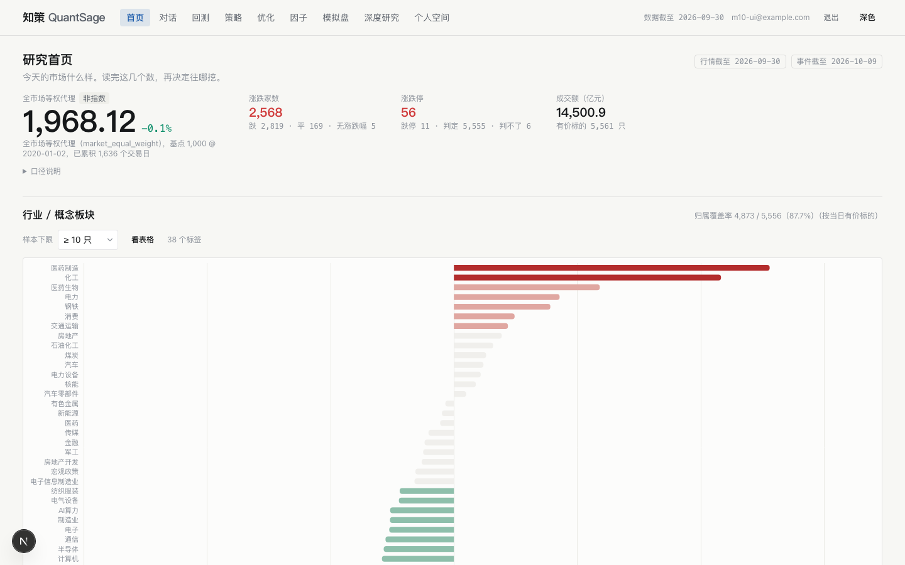
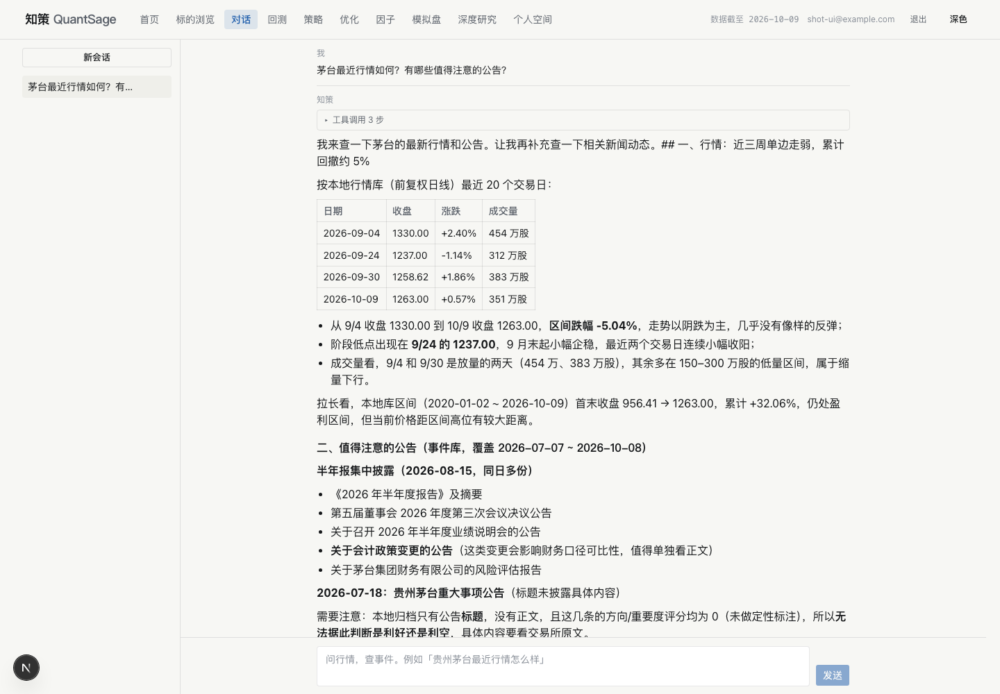
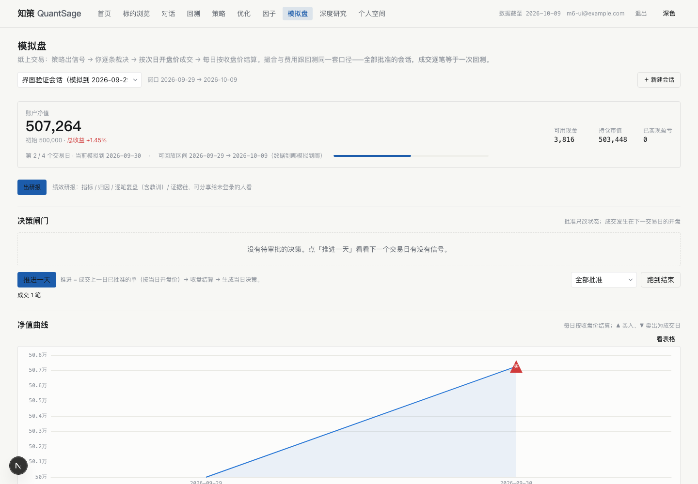
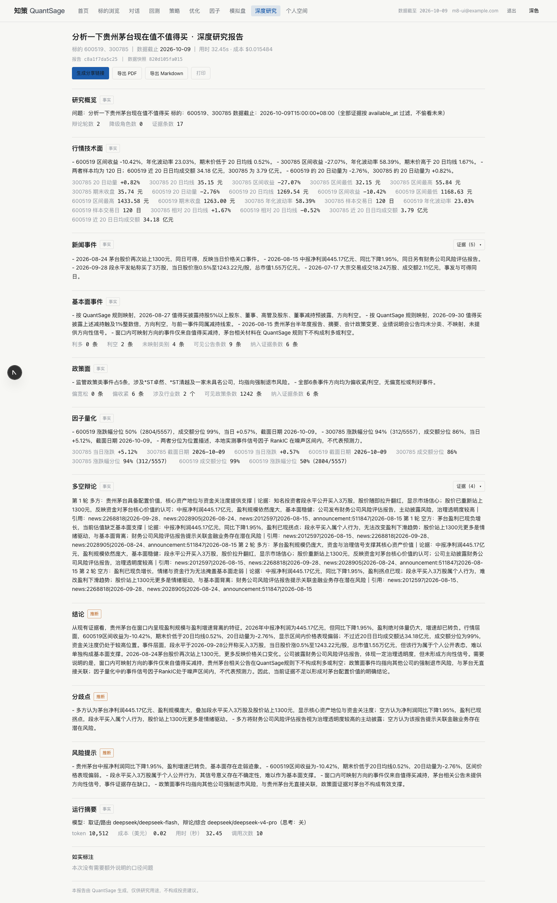
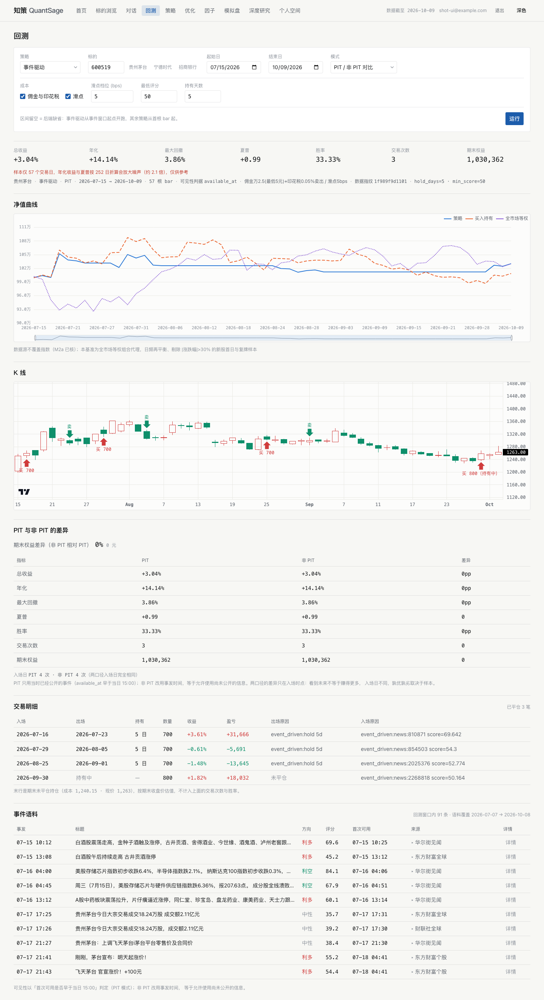

# 知策 QuantSage

**PIT 约束下的 AI 投研 Agent。** Point-in-time research agent for A-share markets.

[](https://github.com/Q-77-i/QuantSage/actions/workflows/ci.yml)


[核心能力](#核心能力) · [架构](#架构) · [快速开始](#快速开始) · [界面](#界面) · [关键读数](#关键读数) · [已知边界](#已知边界) · [文档](#文档)



QuantSage 是一套完整的 Agent 应用：**多 Agent 并行取证 → 对抗辩论 → 单点综合 → 代码化风控 → 人工审批**，再加上 PIT 语义检索与工具调用；回测与模拟盘共用同一套撮合引擎。Agent 链路跑在可持久化、可恢复的 LangGraph 图上。

它解决的核心问题：把「平台首次可用时刻」（`available_at`）作为事件信息可见性的唯一闸门。回测到第 T 天，Agent 只能检索 `available_at <= T` 的语料，策略也拿不到未来 bar——**同一套事件驱动策略，PIT 与非 PIT 可以各跑一次，把「有没有偷看未来」变成可量化的差异**。PIT 约束同时写进数据模型、RAG 服务端过滤与策略静态检查。

> 实测两口径差异与读法见 [事件驱动教程](docs/tutorials/event_driven.md#6-前视偏差对比怎么读)。

## 核心能力

| 能力 | 说明 |
|---|---|
| **多 Agent 深路径** | 意图路由 → 五角色并行取证（取数是代码、解读是 LLM）→ 证据归并 → Bull⇄Bear 辩论（≤3 轮硬上限）→ 单点综合 → 代码化风控闸门 → 超限 `interrupt()` 人工审批 |
| **PIT 语义检索** | BGE-M3 双索引（稠密 + 稀疏）落 Qdrant；`available_at <= as_of` 写进服务端 filter → 双路召回 → 服务端 RRF → bge-reranker 精排；零命中改写一次查询 |
| **回测 + 模拟盘** | 自研事件驱动引擎；A 股撮合规则；PIT / 非 PIT 两口径对比；策略沙箱（子进程 + OS 级隔离）+ AST 前视检查；模拟盘逐条裁决、风控四闸门、决策审计 |
| **Agent 工程化** | 快/深两图共用 Postgres checkpointer；`tasks` 表即队列（`SKIP LOCKED` + 租约/心跳 + 有限重排）；SSE 断线重连；预算四计数器（调用 / token / 墙钟 / 成本）；Langfuse trace；Prometheus / Alertmanager 可选 |
| **评测与可复现** | 200 条中文财经 RAG 评测集（rerank NDCG@10 0.8142）；12 题深研报 rubric（手动轨）；回测绑定 `data_digest` 与 `strategy_version`，同快照可重放 |
| **对外 MCP** | stdio 单工具 `search_events`；Claude Desktop / Claude Code / 任意 MCP 客户端可直接把 PIT 语料当数据源 |

重点不是「接一个模型 + 一个聊天框」：工具白名单、上下文预算、失败降级、人工审批与回测证据都有代码和测试兜底。

工程形态：FastAPI + 独立 RAG 推理进程 + `tasks` 表队列；Postgres 同时承载业务表、checkpointer 与决策记忆。

对外 MCP：`cp .mcp.json.example .mcp.json`，Claude Code / Desktop 即可把 `search_events` 当数据源；实现见 [`backend/app/mcp/server.py`](backend/app/mcp/server.py)。

## 架构

| 层 | 组件 | 职责 |
|---|---|---|
| **接入** | FastAPI ×2（S5 压测档；默认 ×1） | SSE / JSON、鉴权、限流、任务 API |
| **Agent** | 快路径（LangGraph ReAct） · 深路径（StateGraph + HITL） | 工具白名单 / 并行取证 → 辩论 → 综合 → 代码化风控 → 人工审批 |
| **执行** | 单进程 worker 池（backtest×3 + grid/batch×1，队列实体是 `tasks` 表） · 模拟盘 / 研报 | 异步任务、逐条裁决、证据回链 |
| **检索** | RAG 推理服务（BGE-M3 + reranker）+ Qdrant | PIT 服务端过滤、双路召回、RRF、精排 |
| **数据** | PostgreSQL 18 · Parquet + DuckDB · Redis cache + coord | 业务表 + checkpointer + Store / bars + events / L2 缓存 + 共享限流 |
| **观测** | Langfuse · Prometheus + Alertmanager（可选） | LLM trace / 指标与告警 |
| **外部** | 小石 MCP · 对外 MCP Server | 只读数据源 / PIT 检索 |

三条设计取向：

- **控制流交给 LangGraph，合规判断交给纯 Python**：风控闸门与校验不做成 LLM 可决定的节点。
- **「读」并行、「写」单点**：证据取证 fan-out；综合与下单单点。
- **引擎只有一套**：回测、模拟盘、批量 / 网格共用撮合与费用实现；风控关闭时，全部批准的模拟盘成交逐笔等于一次回测。

技术栈：Next.js 15 · FastAPI + Pydantic v2 · LangGraph · Parquet + DuckDB · PostgreSQL 18 · Qdrant · BGE-M3 + bge-reranker · LiteLLM · Langfuse · Prometheus / Alertmanager（可选）。运行时拓扑与关键决策见 [企业级架构设计](docs/enterprise/architecture.md)。

## 快速开始

前置：Docker、[uv](https://docs.astral.sh/uv/)、Node 24 + pnpm、Python 3.12。

```bash
cp .env.example .env      # 1. 配置环境变量（模板含全部变量与逐条说明）
docker compose up -d --wait   # 2. 起基础设施（加 --profile observability 连 Langfuse 一起起）
cd backend && uv sync && uv run python scripts/init_checkpoint_db.py   # 3. 建 checkpointer 表（首次必需）
uv run uvicorn app.main:app --port 8000                                # 4. 后端 → http://127.0.0.1:8000
cd ../frontend && pnpm install && pnpm dev                             # 5. 前端 → http://127.0.0.1:3001
```

一键起（基础设施 + RAG + 后端 + 前端）：`bash scripts/dev.sh`（`status` / `health` / `stop` / `restart` / `logs` 同脚本）。

本机已有 `data/` 快照时，没有小石密钥也能跑通回测与前端；新克隆的仓库需先按下方「数据」拉取（需授权密钥）。生产形态、资源上限、备份/恢复见 [企业级架构](docs/enterprise/architecture.md)（§2.1 / §7 / §9）。

开发：`cd backend && uv run pytest`（离线）；CI 跑 lint、前端测试、依赖审计与 Prometheus 规则，覆盖率门槛 88%。

### 数据

`data/` 与 `.tools/` 不入 Git。首次运行需拉取行情与事件（需小石授权密钥）：

```bash
cd backend
uv run python scripts/download_bars.py --status
uv run python scripts/download_events.py --backfill
uv run python scripts/audit_calendar.py
```

事件语料滚动保留（新闻约 3 个月）；教程数字绑定数据快照，换快照后数字会变、结构与读法不变。

## 界面

| 对话 | 模拟盘 |
|---|---|
|  |  |

| 深度研究 | 回测 |
|---|---|
|  |  |

更多截图（策略工作台 / 网格 / 因子 / 研报 / 标的浏览）见 [`docs/images/`](docs/images/)。

## 关键读数

> 单机演练读数，不是 SLA。

| 项 | 读数 |
|---|---|
| 2w bars c=300 | **1,710 req/s / p95 280ms** |
| 20 回测 queue p95 | **503ms** |
| RAG hybrid 交互 p95 | **0.79s** |
| 缓存命中率 | **99.5%** |
| 故障演练 / 备份恢复 | **8 行通过**；备份 4.6GB、恢复 **36.3s** |

逐项口径、before/after 与原始证据见 [ROADMAP](ROADMAP.md) 与 [P4-Sn SPEC §13](docs/specs/P4-Sn.md#13-变更记录)。

## 已知边界

- **数据窗口由数据源决定**：新闻约 3 个月滚动；行情走 canonical（完成版），不承诺「落后一天」。
- **模拟盘是回放式、单账户多标的等额配额**：不是实时、不是组合优化、不含实盘；风控开启后不再与回测逐笔平价。
- **深研报的叙述层受模型知识截止影响**：数字由代码取并过追溯闸门，叙述没有对策。
- **提示注入只做纵深防御**：`<untrusted_data>` 是其中一层，不是「解决了注入」。
- **冻结交易日历止于 2026-12-31**：等上游 2027 假期数据，不用工作日近似。
- **单机形态**：不是生产级高可用 / SLA；MQ / K8s / 多机 HA 不引入，触发条件写在架构文档。

## 文档

| 文档 | 只回答什么 |
|---|---|
| [docs/PRD.md](docs/PRD.md) | 做什么、为什么、验收标准、排期 |
| [docs/specs/](docs/specs/) | 技术契约、实现细节与变更记录（技术源） |
| [docs/enterprise/](docs/enterprise/) | 架构 / 风控 / 评审 / 复盘深读 |
| [docs/tutorials/](docs/tutorials/) | 使用教程 / FAQ / 示例策略 |
| [ROADMAP.md](ROADMAP.md) | 阶段状态、验收读数、下一步 |
| [CHANGELOG.md](CHANGELOG.md) | 按里程碑的交付记录 |
| [CLAUDE.md](CLAUDE.md) | 项目定位、技术栈、关键决策与协作规则 |
| [docs/PROJECT_STRUCTURE.md](docs/PROJECT_STRUCTURE.md) | 目录与模块职责导航 |

完整 API 见运行后的 `/docs`；SSE / 任务 / 鉴权契约见 [企业级架构 §4](docs/enterprise/architecture.md#4-六条关键链路)。

## License

[MIT](LICENSE)
