# 知策 QuantSage

**前视偏差为零的 AI 投研 Agent。** Point-in-time research agent for A-share markets.

[](https://github.com/Q-77-i/QuantSage/actions/workflows/ci.yml)


[使用教程](docs/tutorials/getting-started.md) · [常见问题](docs/tutorials/faq.md) · [快速开始](#快速开始) · [已知边界](#已知边界) · [ROADMAP](ROADMAP.md) · [CHANGELOG](CHANGELOG.md)

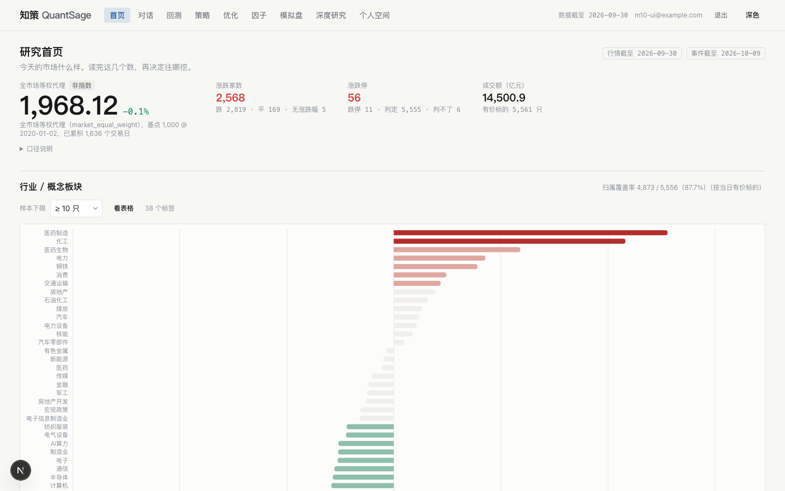

把「平台首次可用时刻」（`available_at`）作为信息可见性的唯一闸门——回测时，Agent 与策略只能看到那个时点之前真正拿得到的信息。绝大多数「LLM + 量化」项目用抓取时间戳或无过滤地检索全量语料，回测结果在无意识地穿越未来；本项目把这条约束压进数据模型、检索与回测引擎，并把它做成可量化的对比。

> **进度**：P1-Tn / P2-Mn / P3-En 全部交付并验收（`m-p1` / `m-p2` / `m-p3`）。浏览器内可走完一条完整链路——对话取证 → 写策略 → 回测 → 网格与过拟合检验 → 模拟盘 → 绩效研报 → 多 Agent 深度研究；企业级部分补齐了任务队列、多用户治理、数据工程、可靠性、风控、安全与可观测。逐段状态见 [ROADMAP.md](ROADMAP.md)，里程碑交付见 [CHANGELOG.md](CHANGELOG.md)。

---

## 护城河：PIT 约束

三个时间戳贯穿全链路：

| 字段 | 含义 |
|---|---|
| `event_time` | 事件**事发**时刻 |
| `available_at` | 平台**首次可用**时刻（本项目的闸门） |
| `observed_at` | 本系统**观察到**的时刻 |

PIT（Point-in-Time）模式下，某条事件对某根 K 线是否可见，取 `available_at` 与该 K 线的收盘时刻（15:00 Asia/Shanghai）比较——15:00 之后才可得的消息顺延到下一交易日。非 PIT 模式改用 `event_time`，等同假设「事发即知」，用于量化两种口径的差异。

两个模式的**全部差别压缩在一个方法里**（[`EventView.stamp()`](backend/app/backtest/types.py)），下游引擎、策略、报告零感知；同时 `BarContext.history` 是切片元组，策略在物理上拿不到未来 bar。

**实测（T5 / 2026-10-05 / 三标的样本快照，同一区间）**：非 PIT 相对 PIT 的期末权益差异为 **−0.68% / −4.08% / 0.00%**。差异方向**不预设、可正可负**：两模式信息集相同、只差时点，「更早入场」不等于更高收益。所以本项目的表述是「PIT 约束保证回测不偷看未来」——**不是**「偷看未来一定赚更多」，后者被自家实测数据推翻。详细读法见 [事件驱动教程](docs/tutorials/event_driven.md#6-前视偏差对比怎么读)。

同一策略、同一区间、同一批事件，**只换拿哪个时间戳设卡**——差异全落在末行那两天上：

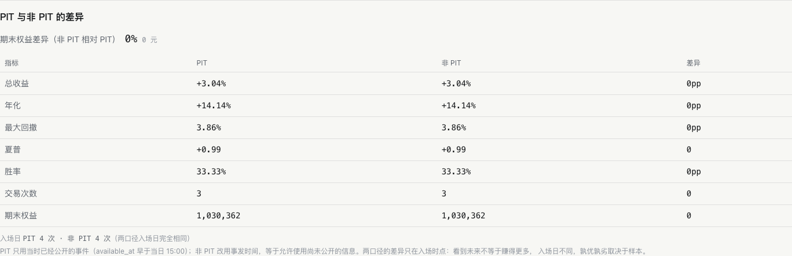

图里用的是 `min_score=60`。**默认门槛（50）下这个窗口的差值是 0.00pp**：唯一一条跨线事件（事发在 15:00 收盘前、平台在收盘后才给出）当天被另一条设卡更早的事件抢先触发了买入，于是它落进持有期、没当成决策者。抬到 60，它成为触发者——**PIT 晚一天入场，期末权益差 +0.52%**。

两档都写出来是有意的：**PIT 约束的价值是「保证回测不偷看未来」，不是「保证每次都拦出差值」**。哪一档更值得看由数据决定，不由结论预设。

**第二道闸门在用户代码层**：「写策略」这条路上，运行前会做一次只读 AST 检查，拦下 `shift(-n)` / `bfill` / 越界索引这类未来函数，error 命中即拒绝运行。

---

## 快速开始

前置：Docker、[uv](https://docs.astral.sh/uv/)、Node 24 + pnpm、Python 3.12。

```bash
cp .env.example .env      # 1. 配置环境变量（模板含全部变量与逐条说明）
docker compose up -d --wait   # 2. 起基础设施（加 --profile observability 连 Langfuse 一起起）
cd backend && uv sync && uv run python scripts/init_checkpoint_db.py   # 3. 建 checkpointer 表（首次必需）
uv run uvicorn app.main:app --port 8000                                # 4. 后端 → http://127.0.0.1:8000
cd ../frontend && pnpm install && pnpm dev                             # 5. 前端 → http://127.0.0.1:3001
```

（3001 是因为 3000 归 Langfuse。）

**一键起（基础设施 + checkpointer 表 + 后端 + 前端）**：

```bash
bash scripts/dev.sh          # 默认 start；已占用的 8000/3001 会跳过，不重复起
bash scripts/dev.sh status   # compose / 端口 / 健康检查
bash scripts/dev.sh stop     # 停应用，不动基础设施；手动起的进程用 stop --force
bash scripts/dev.sh restart  # 停应用后重新起；手动起的进程用 restart --force
bash scripts/dev.sh logs     # 同时 tail 后端与前端日志
```

脚本假定 `.env`、`backend/.venv`、`frontend/node_modules` 已就绪；缺了会给出对应命令。
它不替代手动步骤——只是把第 2–5 步串起来。`pnpm build` 前仍要停 dev（共用 `.next`）。

提交前闸门（可选，一次设置）：`git config core.hooksPath .githooks` —— 提交时自动跑一遍后端 `ruff check`（亚秒级，与 CI 的 lint 步骤同源）；`git commit --no-verify` 可跳过。离线套件与集成套件留给 CI，不进钩子。

没有小石密钥也能跑通回测与前端——行情与事件已在本地落盘；只有「对话页调小石实时工具」这一步需要授权密钥。

### 测试

```bash
cd backend && uv run ruff check .                              # lint
cd backend && uv run pytest                                    # 离线
cd backend && uv run pytest --cov=app --cov-fail-under=88      # 离线 + 覆盖率门槛（CI 口径）
cd backend && uv run pytest -m integration                     # 集成（需容器与真实密钥）
cd frontend && pnpm test && pnpm typecheck && pnpm lint
cd backend && uv run python scripts/build_deep_eval.py --limit 3   # 深研报 rubric（手动轨，真模型/真数据）
```

CI（GitHub Actions，见徽章）跑的是**上面前五条 + 前端四条 + 两端的依赖审计**。集成那一行不在 CI 里——
它要真容器、真密钥与真实行情语料（`data/` 不入库），所以**徽章变绿不等于全部测试通过**。
覆盖率门槛是 **88%**（E7b 按当时 CI 基线 89.36% 定标；E9 收口时离线 **1797 passed**，2026-10-20；两端差异的来源与排除依据见 [P3 SPEC](docs/specs/P3-En.md) §7.3）。

命令行跑一次回测、复现教程里的数字，命令见[示例策略教程](docs/tutorials/ma_cross.md#3-复现)。

---

## 功能一览

| 能力域 | 内容 |
|---|---|
| **数据层** | 全市场 A 股日线：`cn-daily` 21 片 = 2020–2026 × raw/qfq/hfq，DuckDB 直读 Parquet **零 ETL**；PIT 事件语料按日落盘（一条事件一行、标的是数组，带 `source` / `original_source` / `content_hash` 溯源三元组）；交易日历冻结为仓库内文件，运行期零第三方依赖 |
| **PIT 语义检索（RAG）** | 事件语料建 BGE-M3 双索引（稠密 + 稀疏）落 Qdrant，管线为「`available_at <= as_of` **服务端硬过滤** → 双路召回 → 服务端 RRF → bge-reranker-v2-m3 精排」；Agent 工具 `search_events` 可显式传 `as_of`，回答「那个时点当时能看到什么」；**零命中时改写一次查询**（同一 `as_of`，透明告知，不静默换查询） |
| **Agent 对话（快路径）** | LangGraph 单 Agent，经 LiteLLM 网关调快档模型；小石 11 个工具收敛为 **4 个只读白名单**（动作型工具不进 LLM 工具集）；另有本地行情 / PIT 检索工具与**模拟盘提案工具**（`list_paper_accounts` 只读、`propose_paper_order` 只创建待审批决策，不能批准/成交/改风控）；SSE 流式五类帧；会话列表 / 历史回看；Langfuse 全链路 trace |
| **回测引擎 + 策略沙箱** | 自研最小事件驱动引擎：信号当根收盘生成、**次根开盘成交**；A 股撮合（100 股整手、佣金万 2.5 最低 5 元、卖出印花税 0.05%、滑点 5bps）与涨跌停规则；用户策略 `on_bar(ctx[, p])` 契约 + 受限命名空间 + 子进程三层配额 + **OS 级隔离**（macOS `sandbox-exec` / Linux `bwrap`：只读代码与数据、禁网络与任意 exec），**运行前 R0–R5 静态拦未来函数** |
| **分析输出** | 总收益 / 年化 / 最大回撤 / 夏普 / 胜率 / 交易次数，基准可选买入持有或**全市场等权代理**；`pit_comparison` 量化两口径差异；参数网格 + 热力图 + **过拟合检验（Deflated Sharpe）**；因子分析（RankIC / 分层 / 多空价差），读数落在噪声区间就如实说 |
| **模拟盘与研报** | 回放式纸上交易：策略出信号 → **你逐条裁决** → 按次日开盘价成交 → 每日收盘结算；可选 **E5 风控**（总仓位 / 单标的集中度 / 止损 / 回撤，止损单自动批准且不可驳回）；**Agent 也能提案，但只能创建待审批决策**——逐条人工裁决，有待审批提案时「一键跑到底」直接拒绝；**风控关闭时全部批准 ⇔ 一次回测（逐笔相等）**，风控开启会缩量 / 拦截，不再承诺逐笔相等。绩效研报容器含归因、逐笔复盘（含到期结算后的教训）、**证据追溯**、分享给未登录的人、一键导出 PDF（服务端渲染） |
| **深度研究（多 Agent）** | 意图路由 → 五角色**并行取证**（取数是代码、解读是 LLM）→ 证据归并 → Bull⇄Bear 辩论（≤3 轮硬上限）→ 单点综合 → **代码化风控闸门** → 超限 `interrupt()` 人工审批；过程可视化与 Langfuse trace 同源 |
| **账户与工作台** | 注册登录与**数据隔离**（越权与不存在同返 404）；自选股与分组；个人空间四页签；我的回测重开；在线策略工作台（Monaco **本地资源、零 CDN**）+ **版本历史 / diff / 回滚**（回滚 = 追加新版本；只改名不增版）；回测页的策略下拉可选**内置或「我的策略」**（跑的是库里那条源码，先保存才能跑；回测记录绑定当次 `strategy_version`） |

---

## 界面

**对话页**——SSE 流式渲染，工具调用步骤可展开；回答自带来源标注与事件时间：

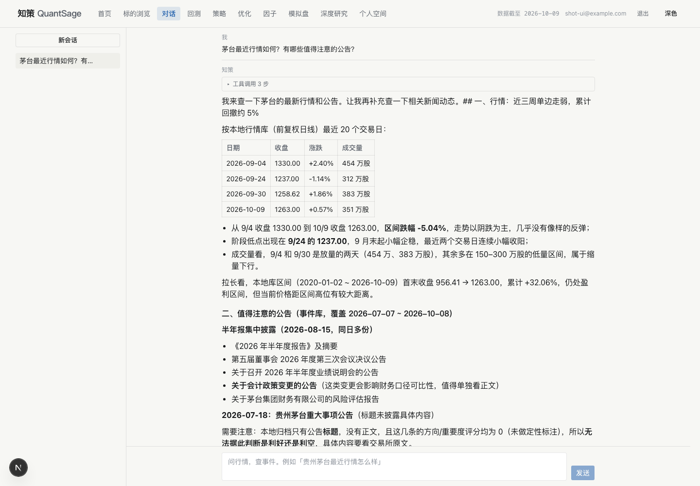

**回测页**——参数表单、指标卡、净值曲线（策略 / 买入持有 / 全市场等权三条）、K 线买卖点、PIT 对比表、交易明细、事件表（`event_time` 与 `available_at` 并列 + 来源）：

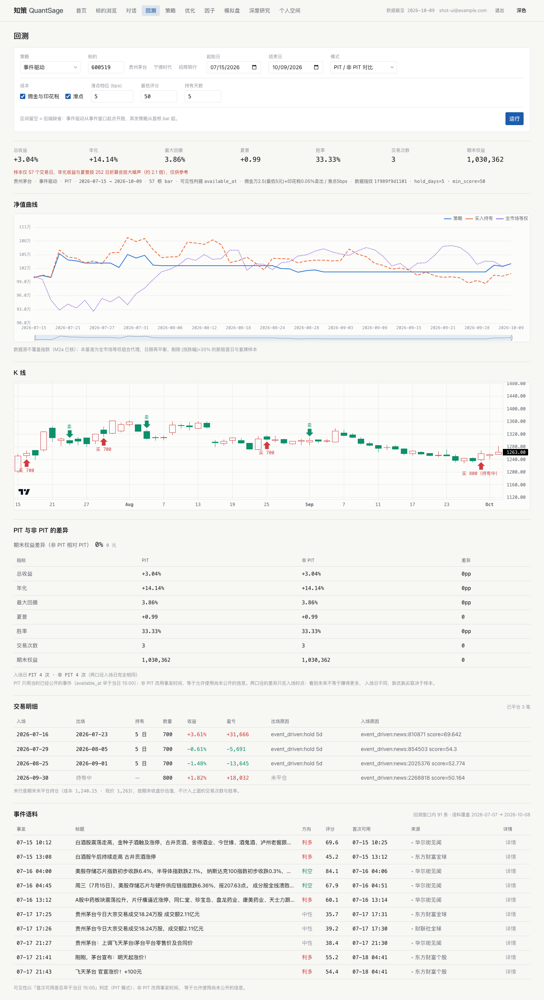

**策略工作台**——在线写策略、调参数、跑回测；编辑器下方是检查结果与运行条。一份注入未来函数的策略会在**运行前**被拦下，越界索引与数据绕行各给一条带行号的 error，编辑器同处出现波浪线：

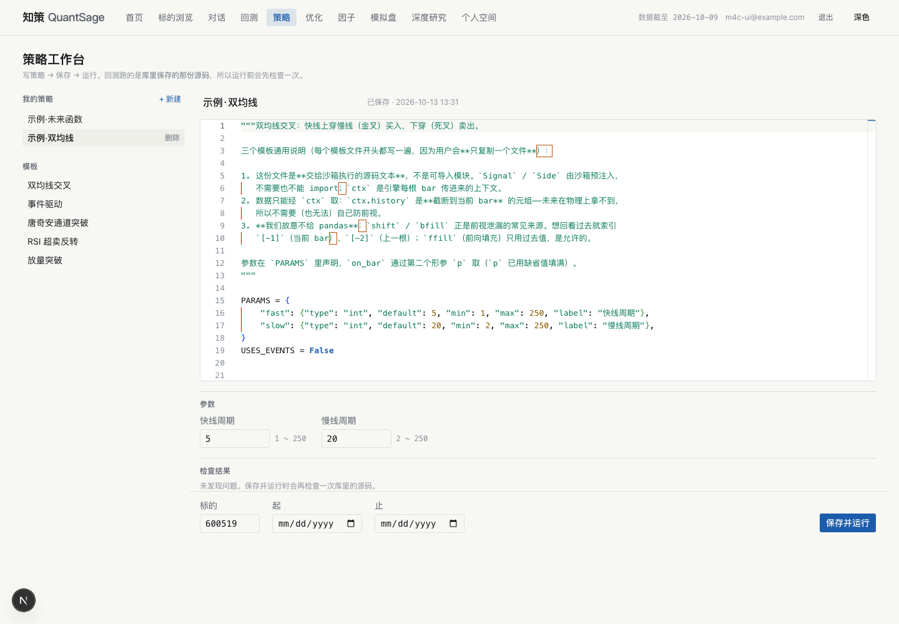
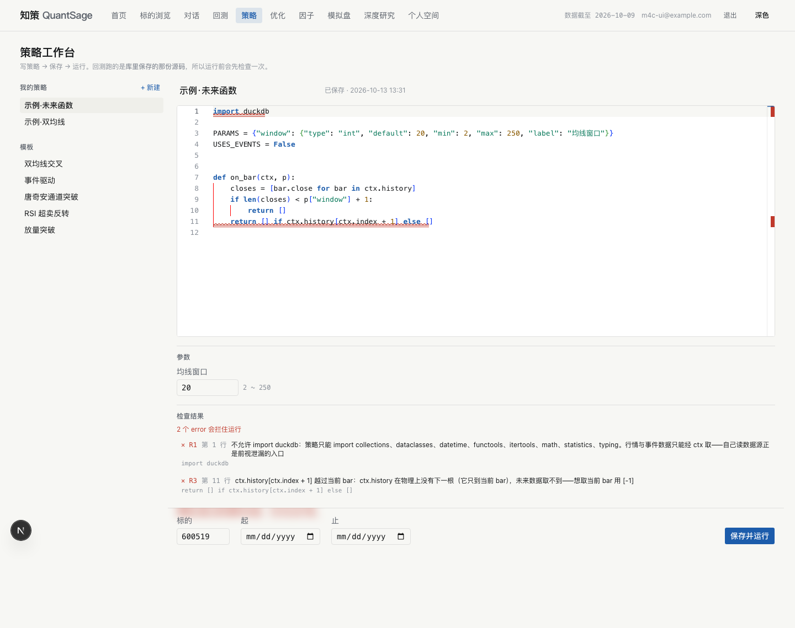

**优化页**——参数网格逐格推送，出夏普分布、热力图（带表格视图孪生）与过拟合检验。**因子分析**——逐日 RankIC、五档分层净值、多空价差（毛 / 净双轨）：

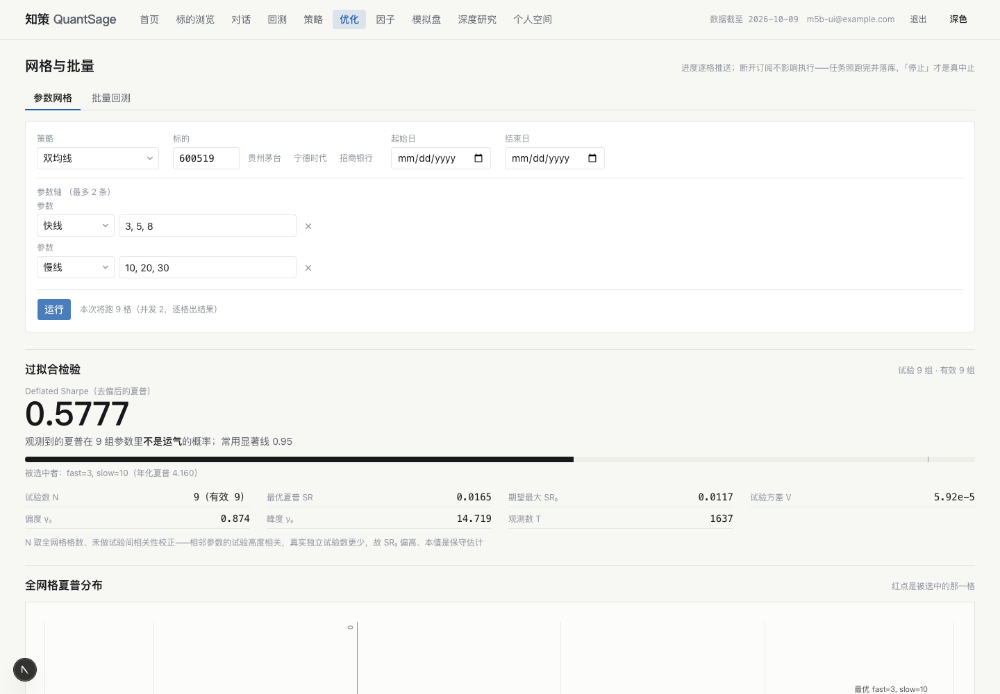
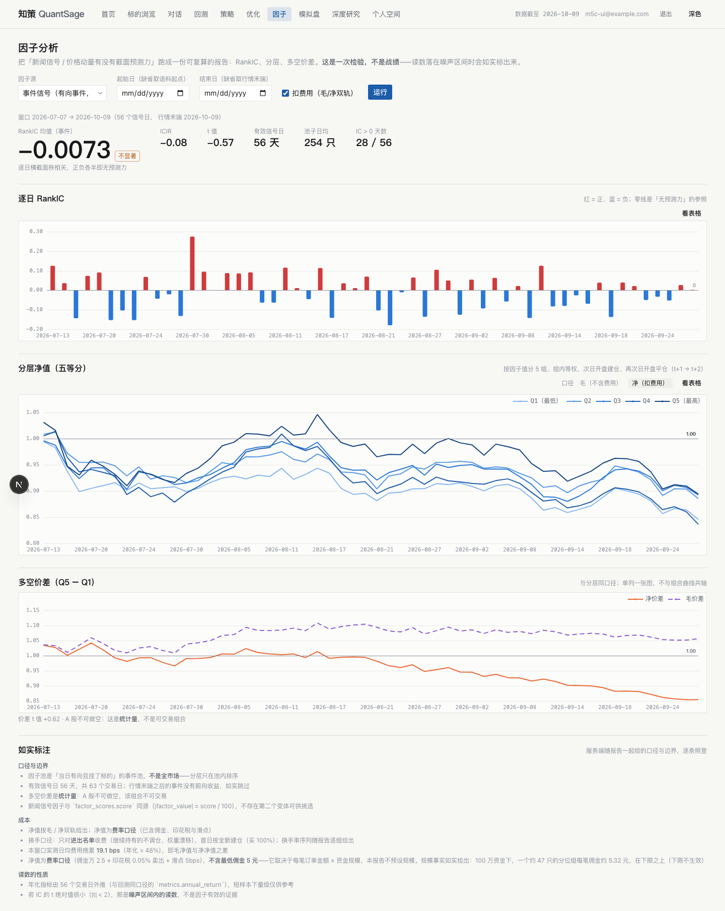

**模拟盘**——纸上交易：策略出信号、你逐条裁决、按**次日开盘价**成交、每日收盘结算。**批准 ≠ 成交**；六态徽章、净值曲线标出成交日；可选风控状态与逐条审计日志（放行 / 缩量 / 拦截 / 触发）：

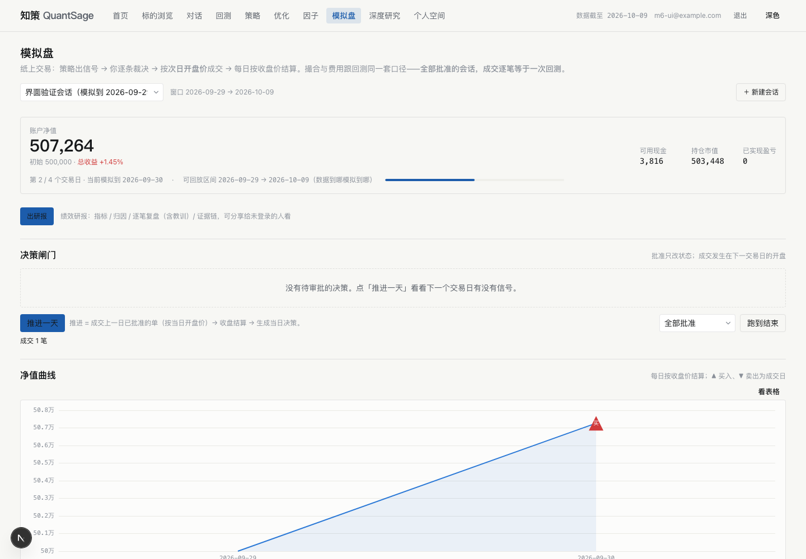

**深度研究**——多 Agent 并行取证的过程看得见：阶段带 + **并行瀑布（条长就是真实耗时）** + 预算计量条；需要人拍板时停下给审批卡：

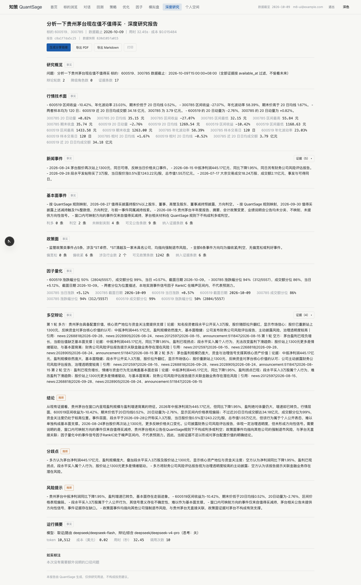

**研报**——绩效研报与深研报共用同一个容器：正文每个数字可点开追溯来源、可分享给未登录的人、**一键导出 PDF**：

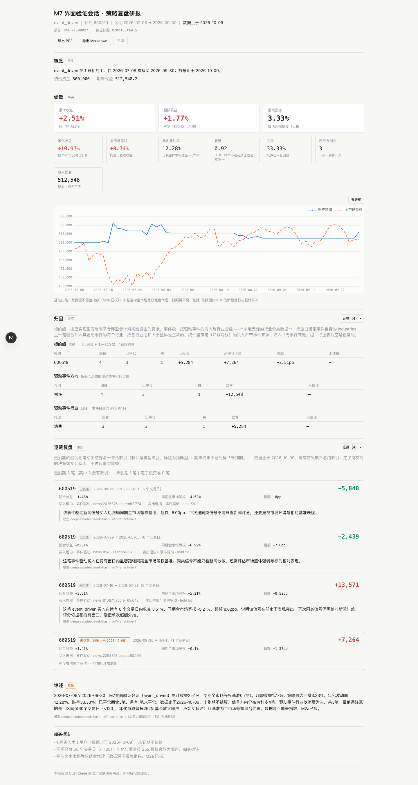

**标的浏览**——全市场列表（搜索 / 排序 / 真分页）与个股页（K 线 + 事件时间线 + 加自选 + 去回测）：

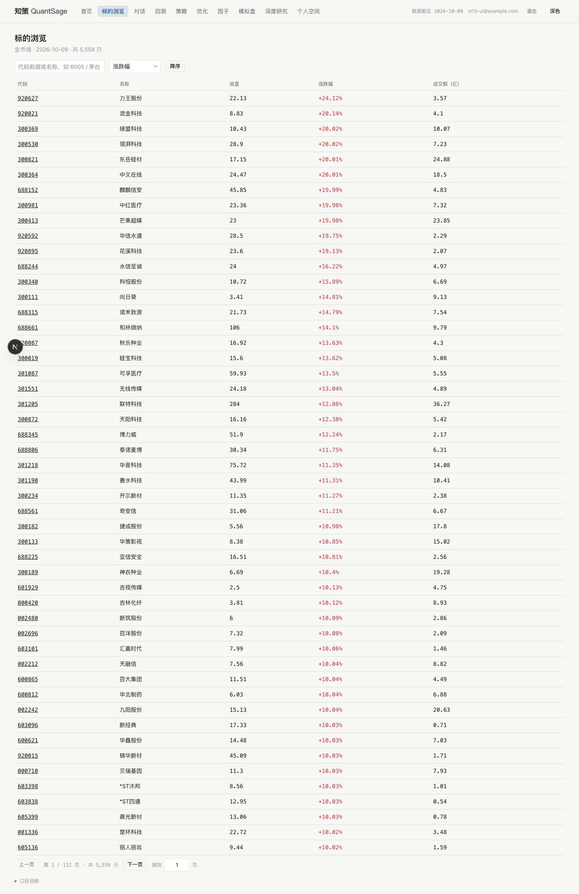
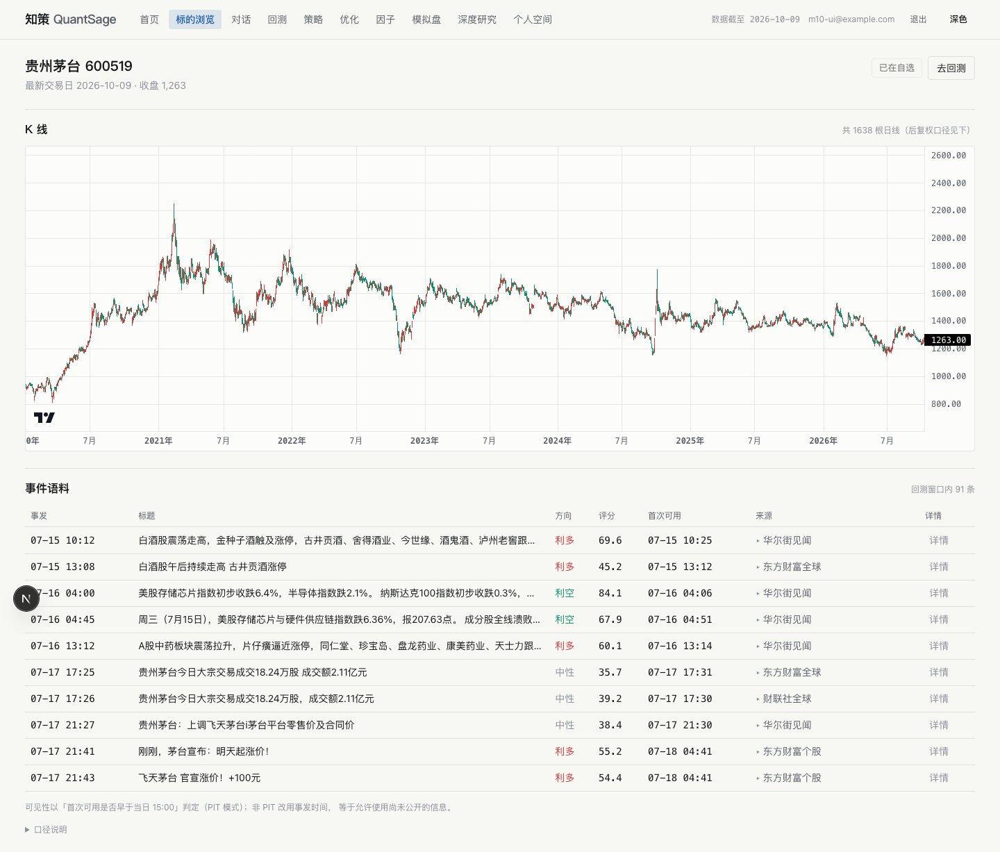

---

## 架构

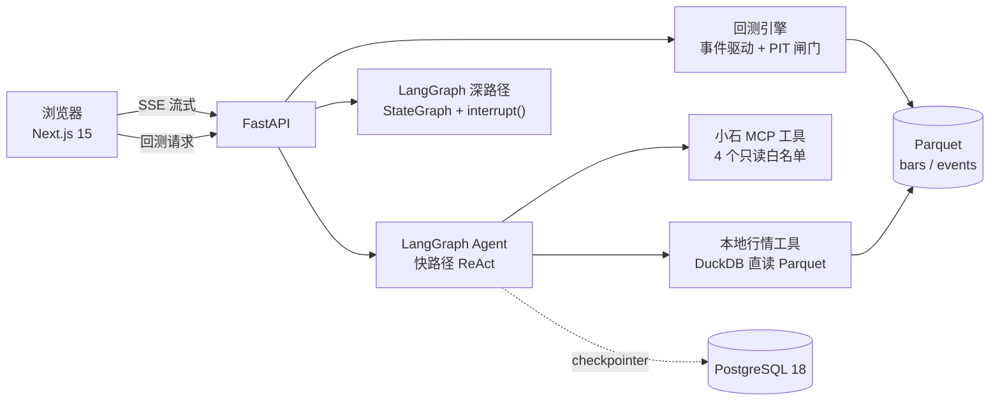

三条设计取向：

- **控制流交给 LangGraph，合规判断交给纯 Python**——风控闸门与校验不做成 LLM 可决定的节点
- **「读」并行、「写」单点**：快路径是单 Agent ReAct；深路径是另一张 StateGraph（并行取证 fan-out → 归并 → 辩论 → 单点综合 → 代码化风控闸门 → 超限 `interrupt()` 人工审批），两图共用 Postgres checkpointer 但独立 thread 命名空间
- **引擎只有一套**：回测、模拟盘、批量 / 网格共用同一个撮合与费用实现。可验证的推论：**风控关闭时，全部批准的模拟盘会话，成交逐笔等于一次回测**——不是承诺，是同一批对象的必然结果。风控开启时会按上限缩量或拦截，**不再承诺逐笔相等**（设计取舍，界面与文档都写明）

**技术栈**：Next.js 15 · FastAPI + Pydantic v2 · LangGraph · Parquet + DuckDB · PostgreSQL 18 · Qdrant · BGE-M3 + bge-reranker · LiteLLM · Langfuse · Prometheus（`/metrics`）。权威的选型表与落地状态见 [CLAUDE.md](CLAUDE.md) §二；运行时拓扑与关键决策见 [企业级架构设计](docs/enterprise/architecture.md)。

---

## API

后端起来后，**完整清单见交互式文档** [`/docs`](http://127.0.0.1:8000/docs)。下表只列几条契约上有讲究的：

| 方法 | 路径 | 用途 |
|---|---|---|
| GET | `/health` · `/health/ready` | 存活 / 就绪探针（就绪含 Postgres 检查），公开 |
| POST | `/api/v1/auth/register` · `/login` · `/logout`，GET `/me` 🔒 | cookie 会话（httpOnly + SameSite=Lax） |
| POST | `/api/v1/chat` 🔒 | SSE 流式问答（`token` / `tool_call` / `tool_result` / `done` / `error`） |
| POST | `/api/v1/backtest` 🔒 | **提交回 202 + `{task_id}`**（异步执行）；报告经 `GET /api/v1/backtest/runs/{run_id}` 取回。`strategy="user"` 时带 `strategy_id` 走沙箱 |
| GET · POST | `/api/v1/tasks` · `/api/v1/tasks/{id}` · `/api/v1/tasks/{id}/cancel` 🔒 | 任务列表 / 状态轮询 / 取消（在跑的网格走协作式中止）；`error` 带 `kind`（用户代码的运行期异常另带 `line`） |
| GET | `/api/v1/tasks/{id}/events` 🔒 | 任务进度流（SSE）：发起与**断线重连**共用同一份帧 |
| GET | `/api/v1/market/{symbol}/probe` | 6 位代码体检。**「本地没有」是 200 + `has_data:false`，不是 404** |
| GET · POST | `/api/v1/etl/status` · `/api/v1/etl/run` 🔑 | 语料覆盖 / 缺口 / 调度器状态；手动触发（后台执行，已在跑 409）。**归 admin**——一次触发是全局动作 |
| GET | `/api/v1/admin/usage` · `/api/v1/admin/rejections` 🔑 | 配额用量与拒绝记录（**只读**；授撤角色走 `scripts/grant_admin.py`） |
| GET | `/.well-known/agent-card.json` | 公开只读**静态能力卡**（A2A 卡形状，**不是 A2A 协议**；无传输/任务/推送） |
| GET · POST | `/api/v1/strategies/{id}/versions` · `.../versions/{n}` · `.../versions/{n}/diff` · `/rollback` 🔒 | 策略版本历史 / 详情 / 统一 diff / 回滚（回滚 = 追加新版本） |

🔒 = 需登录，🔑 = 需管理员（`users.role = "admin"`，脚本改、立即生效）。**公开面只有 `market/*`、`events`、`factor/report`（公开只读）、`/health`、`/.well-known/agent-card.json` 与 `/metrics`（token / 回环）**；分享页走 `/api/v1/public/reports/{token}` 单独授权，打印导出走一次性签名令牌。其余一律要登录。会话 cookie 走 `httpOnly + SameSite=Lax`，故前端**跟随页面 host** 访问 API——这样 `localhost` 与 `127.0.0.1` 都能用，不会被浏览器按跨站丢掉 cookie。

---

## 把 QuantSage 挂成 MCP 数据源

平台的 PIT 语料检索可以**直接暴露给任何 MCP 客户端**（Claude Desktop / Claude Code / 任何讲 MCP 的 agent）——AI 不只是用我们的页面，而是把我们的数据当数据源用。服务是 stdio 形态（本地单进程，不开端口），实现在 [`backend/app/mcp/server.py`](backend/app/mcp/server.py)。

抄一份配置即可（**命令与参数必须是本机绝对路径**，换机器要改）：

```bash
cp .mcp.json.example .mcp.json   # 再把里面的 /ABSOLUTE/PATH/TO/QuantSage 换成真实路径
```

Claude Code 直接读项目根的 `.mcp.json`（重启后 `/mcp` 可见）；Claude Desktop 把同样的 `mcpServers` 块贴进 `claude_desktop_config.json` 即可。

它暴露**一个工具** `search_events`：

| 参数 | 说明 |
|---|---|
| `query` | 自然语言问题或关键词 |
| `as_of` | 截止时点（`YYYY-MM-DD` 或完整 ISO）。**省略 = 现在**；问「某个历史时点当时市场看到了什么」必须显式传 |
| `symbol` / `event_type` / `top_k` | 限定标的 / 事件类型 / 返回条数（默认 5、上限 10） |

返回结构化 JSON：`as_of`（**实际生效**的时点）/ `coverage`（本地语料窗口）/ `score_kind` / `hits[]`（标题、`event_time` 与 `available_at` 双时间戳、方向、重要度、摘要、标的、来源三元组、得分）。上限自定：摘要截断、整份返回有硬上限且**超出时如实标注丢了几条**；**不设翻页**——检索是排序不是枚举，要更多就换查询词。

三条如实说明：**① 首个调用慢**（要载本地嵌入模型，实测冷启动 **8.8s**，之后每次约 **0.2s**）；**② 默认不精排**（`score_kind="rrf"` 就是这个意思——精排要多载一份 2.3GB 模型）；**③ 服务本身无鉴权**（本地 stdio 单进程形态，读到的是全局语料；多租户部署需另加）。

自检（不需要任何客户端，真 stdio 握手 + PIT 双断言）：

```bash
cd backend && uv run python scripts/verify_quantsage_mcp.py --evidence ../logs/e8/mcp-verification.json
```

另有**静态能力卡** `GET /.well-known/agent-card.json`（公开只读）：把 PIT 检索 / 深度研究 /
模拟盘提案 / 回测四项能力、HITL 与 MCP 的限制写成一份 A2A 卡形状的 JSON。**它不是 A2A 协议实现**
——没有传输、任务或推送；MCP 仍是 stdio 单工具。

---

## 已知边界

这是当前进度的诚实清单，避免读者误判完成度。按主题分组，**没有一条是「以后会好」的托词**。

### 数据与时间

- **事件语料窗口由数据源决定**：新闻源只保留 3 个月（滚动），更早的事件永久不可得——本地语料是「首次回填日 → 最新可用日」，**起点固化、终点随日增量前移**。事件驱动策略对显式早于覆盖起点的请求直接报 400 并给出路
- **行情源侧的节奏不稳定，且分两条质量轨道**：`cn-daily` 按年整片发布、没有日增量可拉，刷新做的是「便宜探测 → 按需整片重下」。平台有 **canonical（complete）** 与 **available** 两条轨道——我们固定用 **canonical**（宁慢不脏：available 快但 `quality_status=partial`，有缺口，且平台明言 `fill_or_forward_fill_allowed=false`）。实测 canonical 的滞后**随发布而变**：10-12 缺当天（T+1），10-13 仍停在 10-09（连缺两个交易日）。**对外别承诺「落后一天」**——它是观测值，不是契约。事件归档按自然日发布、近期还停更过，两者本来就可能不同日，首页因此**并列显示两个「截至」**（悬停可看源侧止于哪天）
- **无价 bar 不进定价路径**：数据源用「整行价量为空」表示某天没观测到成交，`bars()` 只返回四价齐全的行——**无价即无价，不是零价**
- **定时任务（ETL / 行情刷新 / 数据体检 / 决策结算）默认关**：可显式打开或走 `POST /api/v1/etl/run` 手动触发（**需要 admin 账号**）；**定时任务只在后台主实例运行**——同一库的第二个进程只服务 HTTP。归档保留期是滚动的，**断供超过 3 个月那段就永久拿不到了**
- **冻结交易日历止于 2026-12-31**：上游 exchange-calendars 目前没有 2027 假期数据（2026-10-17 复查最新为 4.13.2），X1 体检按 90 天告警。到期前等上游更新后重生成；**不用工作日近似硬扩**（春节 / 调休会静默算错交易日）

### 回测与模拟盘

- **深路径是回放式的、不是实时的**：模拟盘只能回放到**本地行情末端**；深研报锁 `as_of`，可重放但不能「分析此刻」
- **回测引擎不含组合与实盘**：模拟盘是**单账户多标的等额配额**，不是组合优化；样本不足时年化与夏普会被放大，UI 常驻提示。**风控开启的会话不再与回测逐笔平价**——上限是硬顶不是目标（单标的上限在 5 只以上池子里通常不触发），止损按收盘价判定、次日开盘成交，跳空可能成交在更差价位
- **网格/批量与回测一样是任务**：`POST /api/v1/optimize/{grid,batch}` 回 202 + 任务号，进度订阅 `GET /api/v1/tasks/{id}/events`。**断开订阅不影响执行**——关掉页面/刷新，任务照跑完并落库（`?task=` 刷新后自动接回）。「停止」是真取消（协作式），**中止的结果不落库**
- **回测是异步任务，但不是提速**：提交只回 202 + 任务号，执行由**单 worker 串行**消费 `tasks` 表（进程内，不引 Celery/Redis Streams）。实测端到端比旧的同步路径**多 0.6–0.9s**（闸门里那次行情读 + 取件轮询 200ms）——换来的是统一的任务契约与随时可查的状态。**单实例契约**：同一业务库只允许一个进程承担后台任务；启动时用 advisory lock 竞选后台主实例，只有持锁者跑 task worker / ETL / 结算调度器，非持锁进程只服务 HTTP（`POST /etl/run` 与 `POST /data/rollback` 返回 409）。主实例退出后不自动晋升，由 supervisor 重启重新竞选；被重启/崩溃打断的任务**有限次自动重排**（租约 + 心跳 + reaper，默认最多执行 2 次；确定性错误不重试），结果按 `task_id` 幂等，重排不产生重复记录
- **Agent 下单只到提案**：Agent 工具只能创建**当前交易日、待审批**的模拟盘决策，不能批准 / 成交 / 改数量 / 改风控；用户必须逐条裁决，有待审批 Agent 提案时「跑到结束」直接 409。只支持会话池内标的、等额配额买入 / 全仓卖出（M6 不支持部分成交）；不做盘中触发
- **策略版本按内容计**：只有 `code` / `params` 实际变化才 +1，只改名不增版；回滚追加新版本并保留当前名字；删除策略会级联删版本行。模拟盘创建时锁定 `strategy_id + version`（旧会话缺键时按名字回落），回测记录绑定 `strategy_version`，**优化记录本轮不绑定版本**（源码已在任务行冻结，但历史摘要无法证明当时版本）

### RAG、研报与安全

- **延迟与成本的诚实读数**：深路径首问慢在冷启动（本地检索模型首次加载约 18s），实测跨进程端到端 **40.5s 冷启动 / 约 23s 预热**、10 次 LLM 调用、**$0.0156**。检索（召回 + 融合）p95 在 500ms 内达标；**含精排的完整链路是秒级**（CPU / MPS 上的 cross-encoder），口径见 [PRD](docs/PRD.md)
- **外部文本进 prompt 时打了「不可信数据」边界，但那不是「解决了提示注入」**：语料（新闻 / 公告 / 政策）与小石在线接口的返回，进模型前一律包进 `<untrusted_data>` 块并转义分隔标签；真正的闸门是结构性的——深路径角色**不持工具**（读到什么都不触发动作）、数字须有出处、外部源访问可熔断。**边界标记只是纵深防御的一层**，如实写在这里
- **深研报的「解读」落在模型的知识截止之内**：数字全部由代码取、并过一道**可追溯闸门**（对不上材料即拒收），但**那道闸门只管数字、不管叙述**——若分析窗口正好在模型训练数据里，它可能给出「听起来有据」却并非从材料推出来的解读。**目前没有对策**，如实记在这里
- **RAG 一轮纠错只处理零命中**：第一次检索没有结果才改写一次查询，`as_of` / 标的 / 事件类型 / top_k 不变；不做多轮、低分阈值或 HyDE。改写会如实写进工具返回 / MCP `query` 字段，不静默换查询
- **A2A 只有静态能力卡**：`/.well-known/agent-card.json` 是只读元数据，不实现 A2A 协议；MCP 工具面不变（仍是 stdio 单工具 `search_events`）
- **深研报评测是手动轨**：12 题 rubric 数据集 + 自动项 + LLM-judge，**不设及格线、不进 CI**；仓库里的证据是 3 题冒烟（`logs/p3/deep_eval.md`），全量 12 题需真模型/真 Qdrant/真 `data/` 手动跑

### 运行时与可靠性

- **消息队列 / 容器化 / 多 worker 的边界**：不引 MQ（`tasks` 表即队列）、全量容器化暂缓、多 worker 不是受支持形态；四句话的触发判据见 [企业级文档 · 已知边界与未来触发](docs/enterprise/architecture.md#9-已知边界与未来触发)
- **Redis 承担数据层的热点查询缓存**（E3c）：分两层——**L1 进程内**（单次运行内的重复读，实测 48–73×）与 **L2 Redis**（跨请求/跨重启，6–12×），键里带**数据代际**（`_meta` 清单一变键就变，不需要「ETL 之后记得清缓存」这种靠人记的约定）；Redis 挂了**熔断直读**，缓存层的任何异常都不让请求失败。限流/熔断仍走进程内，不依赖 Redis（E4 定稿）；调度器与 task worker 已收口到后台主实例（E 批）
- **服务侧可观测性是最小闭环**（E7e）：`/metrics`（Prometheus 文本）暴露 HTTP 计数 / 耗时、任务表五状态、缓存 L1/L2 命中；`X-Request-Id` 回写，JSON 日志可选。**指标进程内、重启清零、单实例**；调度器与 task worker 已收口到后台主实例，但限流/熔断/指标/并发闸门仍按进程计算——多 worker 不是受支持形态。没有 Prometheus server / 告警，**未引入 OTel SDK**；LLM 的 trace / token / 成本仍看 Langfuse

### 展示与前端

- **自选股的价格取自本地行情快照**：取不到价的标的一律显示「—」，不编数；加入时价是当时最近可得**有价**交易日的收盘价，之后不随行情前移
- **前端只对纯函数做单测**，未引组件测试框架；界面靠 Playwright 走查脚本人工核对

---

## 数据来源与复现边界

行情与事件来自**小石**数据平台（需授权密钥），通过本地 stdio MCP（对话内实时查询）与 `xiaoshi-data` CLI（归档批量下载与校验）两条通道接入。**事件语料走归档**：MCP 单次返回硬顶 500 行且不可翻页，装不下「全市场按日」（实测见 [docs/specs/P2-Mn.md](docs/specs/P2-Mn.md) §3 M2b）。数据落盘后即冻结，**不入 Git**（`/data/` 与 `.tools/` 均被忽略）。

```bash
cd backend
uv run python scripts/download_bars.py --status        # 行情：门禁记忆 / 最近一次刷新
uv run python scripts/download_events.py --backfill    # 事件：回填约 92 天（≈ 归档保留期）
uv run python scripts/audit_calendar.py                # 交易日历 × 行情全期双向对账
```

教程里「照文档逐字复跑即对上数字」有个前提：**同一份数据快照**。两篇教程头部都写死了快照指纹（Parquet 的 sha256 前 12 位）与事件窗口——换一份快照，数字会变，结构与读法不变；事件语料是滚动保留的，读者回填到的窗口起点通常晚于教程，跑出的数字不同属正常。

---

## 项目结构

`backend/`（FastAPI + LangGraph）· `frontend/`（Next.js 15）· `docs/`（PRD / specs / tutorials）· `data/`（不入 Git）。

目录树与职责说明见 [docs/PROJECT_STRUCTURE.md](docs/PROJECT_STRUCTURE.md)。

---

## 文档

| 文档 | 内容 |
|---|---|
| [docs/PRD.md](docs/PRD.md) | 需求、功能清单、验收标准、排期 |
| [docs/specs/](docs/specs/) | 技术规格与变更记录（P1-Tn / P2-Mn / P3-En，逐阶段滚动） |
| [docs/enterprise/](docs/enterprise/) | **企业级文档**：架构设计 · 风控专题 · 代码评审记录 · 事故复盘 + 索引 |
| [docs/tutorials/getting-started.md](docs/tutorials/getting-started.md) | **使用教程**：从注册到出一份研报，假定你只有一个浏览器 |
| [docs/tutorials/faq.md](docs/tutorials/faq.md) | **常见问题**：按症状查（提示语为界面原文，可直接对上） |
| [docs/tutorials/](docs/tutorials/) | 示例策略教程：逻辑、参数、复现命令与期望数字（含数据快照指纹） |
| [ROADMAP.md](ROADMAP.md) · [CHANGELOG.md](CHANGELOG.md) | 阶段状态 / 按里程碑的交付记录 |
| [CLAUDE.md](CLAUDE.md) | 项目定位、架构决策与协作规则 |

---

## License

[MIT](LICENSE)
