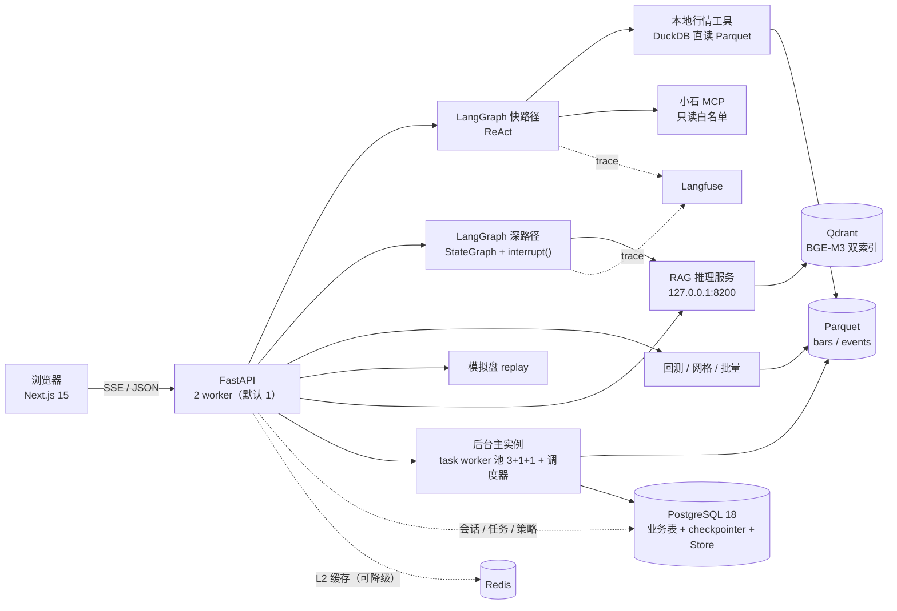

# 架构设计

> 读者：第一次读这个仓库的工程师、面试官。
> 目标：说清系统由哪些进程和存储组成、模块边界在哪、六条关键链路怎么走、哪些决策不可协商、哪些是刻意不做的。
>
> **本文只写不变的结构与理由**；端点、参数、表结构等易变契约以 [P3 SPEC](../specs/P3-En.md) 与运行中的 `/docs` 为准。
> 锚点一律用「文件 + 符号」，不用行号——行号会随重构漂移。

## 1. 一页纸

QuantSage 是一个**前视偏差为零**的 AI 投研 Agent。它把「某个历史时点当时能看到什么」做成数据模型的第一性：每条事件同时带 `event_time`（事发）与 `available_at`（平台首次可得），回测、检索、深研报都按后者设卡。

它**是**：

- 单机可跑的全栈应用：Next.js 15 前端 + FastAPI 后端 + Postgres + Redis + Qdrant + Parquet/DuckDB
- 一条完整链路：对话取证 → 写策略 → 回测 → 网格/批量 → 模拟盘 → 绩效研报 → 多 Agent 深度研究
- 一个可回测、可审计、可复现的研究工具：每次回测绑定数据指纹与策略版本

它**不是**：

- 多租户 SaaS、分布式回测、实盘交易系统（这些是 P4 的愿景，未排期）
- 组合优化器或高频交易系统；模拟盘是单账户多标的等额配额
- 一个「LLM 说什么就执行什么」的 Agent：合规判断在纯 Python 里，Agent 下单只到提案

**三条设计取向**（后文反复出现）：

1. **控制流交给 LangGraph，合规判断交给纯 Python**——风控闸门与校验不做成 LLM 可决定的节点
2. **「读」并行、「写」单点**——证据取证 fan-out，综合与下单单点
3. **引擎只有一套**——回测、模拟盘、批量/网格共用同一个撮合与费用实现

## 2. 运行时拓扑



### 2.1 进程模型

**API 层默认 1 个、可条件跑 2 个 FastAPI worker（S5/S6 压测档即 2w）；后台任务仍只有一个主实例**：

- 启动时用 Postgres advisory lock 竞选**后台主实例**（`BACKGROUND_LOCK_KEY`）
- 只有持锁进程启动 task worker、ETL/行情/体检调度器、决策结算调度器
- 非持锁进程只服务 HTTP；`POST /api/v1/etl/run` 与 `POST /api/v1/data/rollback` 在非主实例返回 **409**
- 主实例退出后不做运行中晋升；uvicorn 补进程后由新进程在启动时重新竞选（`API_WORKERS>1` 时锁重试 3×0.25s）
- 重启时把遗留的 `running` 任务**有限次重排**（基础设施故障，默认最多执行 2 次）；attempt 用尽才标 `failed/lease_expired`；确定性错误不重试

**多 API worker（S5，条件启用）**：`API_WORKERS=2` 时 uvicorn 起 2 个 API worker
（`keep_subprocess_alive` 负责补死掉的进程），任务 worker / 调度器仍只有一个。共享限流
走独立 `redis-coord`（Lua 令牌桶）；coord 不可用降级为进程内 `floor(capacity/N)`。指标用
`PROMETHEUS_MULTIPROC_DIR` + `MultiProcessCollector` 聚合，任务状态由自定义 collector 从
DB 取一次。网格逐格进度落 `tasks.progress.cells`，非 master 的 SSE 每 1s 从 DB 轮询补齐。
回退：`API_WORKERS=1` + `RATE_LIMIT_SHARED=false`。实现后复测 bars c=300
**1,699 req/s / p95 231ms**、`/health` **11,810 req/s**（预测量 1w p95 390ms）。
**S6 最终复测（2026-10-29）**：2w bars **1,710 / p95 280ms**、health **11,599**；1w 864 / 5,784；
p95 比 S5 高、仍在 300ms 门槛内，差异按系统负载噪声如实记录。

这条契约的动机是「单机形态下把跨进程状态压到最少」：任务队列仍单实例；限流与指标在 S5
已跨进程（coord / 多进程聚合），熔断与 DuckDB/模拟盘并发闸门仍按进程计算。详见 §9.3。

**RAG 推理是独立进程**（S3）：`python -m app.rag.service` 只绑 `127.0.0.1:8200`，单进程持有 BGE-M3 + bge-reranker，精排 `max_inflight=1`（MPS 串行）。API/MCP 经 `app/rag/remote.py` 调它；`RAG_SERVICE_URL` 为空时回退到进程内（单 API 进程，不推荐多 worker）。队列满/等待超时返回 503，调用方降级 RRF 并如实标 `degraded_reason`。

**运行底座（S4）**：`scripts/prod.sh` 用 `QS_MODE=prod` 委派 `scripts/dev.sh`，负责
start/stop/status/health/logs 与前端 build+start；prod/dev 端口相同、日志与 PID 分目录
（`logs/prod` / `logs/dev`），不能同时起。API 用 `uvicorn --timeout-graceful-shutdown 15`
停接新请求并 drain 在飞/SSE；worker 停止取件、不 await 在飞任务，退出前把租约释放回
`queued`（attempts−1；已取消收 `cancelled`）；scheduler `shutdown(wait=False)`。日志用
copytruncate 轮转（20MB × 3、30min 检查）。

**资源上限（S4）**：Docker 默认四件有 `mem_limit/cpus`（PG 1.25g、Redis cache 640m、
Redis coord 192m（S5）、Qdrant 2.5g）；Redis cache `maxmemory 512MB` + `volatile-lru`、关闭 RDB；PG
`max_connections=120`、`shared_buffers=512MB`。DuckDB 每连接 `threads=2`、
`memory_limit=1GB`、逐连接 temp 目录；`_fetch` 有进程级查询闸门 4（1GB 是每连接上限，
不是进程上限）。业务池 `statement_timeout=5s`、checkpointer 池 30s。

**子进程**有两类：

- **用户策略沙箱**：`strategy/sandbox.py` 起子进程，`strategy/isolation.py` 在 macOS 用 `sandbox-exec`、Linux 用 `bwrap` 做 OS 级隔离
- **PDF 渲染**：报告导出走独立子进程，避免把 Chromium/字体依赖带进 API 进程

### 2.2 存储职责

| 存储 | 职责 | 关键约束 |
|---|---|---|
| PostgreSQL 18 | 业务表（用户/会话/自选/策略/回测/模拟盘/研报/任务/配额/审计等）+ LangGraph checkpointer + Store | 业务库不可用时后台任务与调度器都不启动；降级接口返回 503；容器 1.25g、`max_connections=120`、`shared_buffers=512MB` |
| Redis 7 | 数据层 L2 热点缓存 + 共享限流协调 | **可降级**：cache 连不上就熔断直读，缓存层异常不让请求失败；容器 640m、`maxmemory 512MB` + `volatile-lru`、不持久化。coord 独立实例（6380、192m、128MB noeviction），只放 `rl:*`；coord 挂了限流降级为进程内 `floor(capacity/N)` |
| Qdrant | 事件语料双索引（稠密 + 稀疏） | PIT 过滤写进服务端 filter；RRF 由服务端做；容器 2.5g |
| Parquet + DuckDB | 行情与事件的事实层 | 直读分片，零 ETL；DuckDB 不承担业务事务；每连接 `threads=2`/`memory_limit=1GB` + 进程级闸门 4 |
| Langfuse | LLM trace / token / 成本 | 与 Prometheus 分工，不在两处重复计 token |

## 3. 模块地图

### 3.1 后端 14 个包

| 包 | 职责 | 不做什么 |
|---|---|---|
| `app/api/` | 17 个挂路由的模块 + 共用件（幂等、限流、SSE） | 不写业务规则；异常到 HTTP 的映射统一在 `main.py` |
| `app/agent/` | 快路径 ReAct 图、工具白名单、请求上下文 | 不决定合规；工具结果视为不可信数据 |
| `app/agent/deep/` | 深路径：路由 / 五角色取证 / 归并 / 辩论 / 综合 / 风控闸门 / 预算 | 角色不持工具；数字由代码取 |
| `app/backtest/` | 事件驱动引擎、PIT 闸门、撮合、成本、指标、报告、A 股规则、批量、过拟合 | 不读业务库；不调 LLM |
| `app/strategy/` | 用户策略沙箱、AST 静态检查（R0–R5）、模板库、版本 | 不在 API 进程里执行用户代码 |
| `app/factor/` | 因子面板与分析 | 独立于回测引擎的数据管道 |
| `app/paper/` | 模拟盘账户 / 撮合 / 回放 / 决策六态 / 风控四闸门与审计 | 风控判据是纯函数；处置只在 replay |
| `app/report/` | 研报容器：组装 / claim 闸门 / Markdown / PDF / 深研报 / 评测 | 推断块不得携带数字；事实块必须自证 |
| `app/memory/` | 决策记忆：到期结算、教训、跨账户聚合（LangGraph Store） | 不做 RAG 检索 |
| `app/rag/` | 嵌入 / 检索 / PIT 硬过滤 / 重排 / 离线评测 / 零命中纠错 | 不把 PIT 过滤放到本地后置 |
| `app/etl/` | 调度器与日增量通道（事件语料、行情按需刷新） | 三条 job 串行；撞锁跳过并留痕 |
| `app/tasks/` | 异步任务执行体 + 单进程内按 kind 的 worker 池取件循环 + 租约/心跳/重排 + 后台主实例锁 + 进度总线 | 队列实体是 `tasks` 表，不引消息队列；任务 worker 仍单实例 |
| `app/data/` | DuckDB 客户端、交易日历、行情刷新、小石 CLI/MCP 装配、体检/快照/回滚/缓存 | 数据落盘后冻结；不引第二数据源 |
| `app/mcp/` | 对外 MCP Server：把 PIT 语料检索亮给外部 AI 客户端 | stdio 单工具；无鉴权、无网络暴露面 |

依赖方向：`api` → 领域包 → `core` / `data`。领域包之间尽量单向；`report` 可以读 `paper`/`memory` 的事实，反向不成立。

### 3.2 前端 18 条路由

| 路由 | 页面 | 说明 |
|---|---|---|
| `/` | 研究首页 | 快捷卡、数据新鲜度、最近活动 |
| `/chat` | 对话 | SSE 流式、工具步骤、历史回看 |
| `/stocks` · `/stocks/[symbol]` | 标的浏览 / 个股页 | 搜索、排序、K 线、事件时间线 |
| `/backtest` | 回测 | 参数、指标、净值、PIT 对比、交易明细 |
| `/strategies` | 策略工作台 | Monaco 本地资源、版本历史 / diff / 回滚 |
| `/optimize` | 网格 | 逐格进度、热力图、过拟合检验 |
| `/factor` | 因子分析 | RankIC、分层净值、多空价差 |
| `/paper` | 模拟盘 | 决策六态、风控状态、审计日志 |
| `/research` | 深度研究入口 | 发起、历史运行 |
| `/research/runs/[id]` | 深度研究运行页 | 阶段带、并行瀑布、审批卡 |
| `/research/[id]` | 深研报 | 证据回链、分享 |
| `/space` | 个人空间 | 自选、回测、会话、策略、优化、模拟盘、深研（7 页签） |
| `/admin` | 管理视图 | 配额用量、拒绝记录（仅 admin） |
| `/login` · `/register` | 登录 / 注册 | cookie 会话 |
| `/r/[token]` | 公开分享页 | 未登录可读 |
| `/print/[id]` | 打印外壳 | PDF 导出 |

## 4. 六条关键链路

### 4.1 快路径 Chat

`POST /api/v1/chat`（SSE）→ `agent/graph.py::build_agent` 的 ReAct 图 → 工具调用 → 五类 SSE 帧（`token` / `tool_call` / `tool_result` / `done` / `error`）。

- 工具面：本地行情、PIT 检索、小石 4 个只读白名单、模拟盘提案（只创建待审批决策）
- 外部数据进 prompt 前包 `<untrusted_data>`（`core/untrusted.py::wrap_untrusted`）
- 会话过 Postgres checkpointer；断连不取消，重连可续
- 每条 trace 进 Langfuse（模型、token、成本、工具序列）

### 4.2 深路径多 Agent

`POST /api/v1/research/runs` → `agent/deep/graph.py`：

```
START ─┬─ market ─┐
       ├─ news ───┤
       ├─ fundamental ─┼─► merge_evidence ─► bull ⇄ bear ─► synthesize ─► risk_gate ─► END
       ├─ policy ─┤                                        （超限 interrupt 等人）
       └─ factor ─┘
```

- 五角色**并行取证**，每个节点自带 try/except——同 superstep 内任一节点抛异常会取消兄弟节点，所以取数失败必须就地翻成 `errors`
- 辩论 ≤3 轮硬上限；综合单点；风控闸门是代码，不是 LLM
- 预算四计数器（调用数 / token / 墙钟 / 成本）到限在节点边界停
- 超限走 `interrupt()` 人工审批；状态过 checkpointer，可恢复

### 4.3 回测任务

`POST /api/v1/backtest` → **202 + `{task_id}`** → `tasks` 表 → 单进程内 worker 池取件（backtest×3 + grid/batch 各 1）→ `backtest/engine.py` → 报告。

- 信号当根收盘生成、**次根开盘成交**；A 股整手、佣金/印花税/滑点、涨跌停规则
- PIT 模式按 `available_at` 设卡；非 PIT 按 `event_time`，两口径差异写入报告（方向不预设）
- 报告绑定 `data_digest`（窗口内分片指纹）与 `strategy_version`
- 提交与执行分离；断开订阅不影响执行，任务照跑完并落库

### 4.4 模拟盘 + 风控

策略出信号 → 生成决策（六态）→ 用户逐条裁决 → 次日开盘成交 → 每日收盘结算。

- `paper/replay.py` 是**纯函数**：同一份输入必得同一个账户状态；跨请求靠「从会话起点重放」保留策略实例
- 四闸门（`paper/risk.py`）：总仓位 / 单标的集中度 / 止损 / 回撤
  - 仓位与集中度**先缩量，不足一手才拦截**
  - 止损生成 `approved` 风控卖出，**自动批准且不可驳回**
  - 回撤只禁新开仓，恢复后自动解禁
- 每次处置写 `decision_audit`，界面可逐条查
- Agent 只能在当前 `as_of` 创建 `pending`、`origin=agent` 的决策；不能批准/成交/改风控

### 4.5 PIT 检索

`as_of` → Qdrant 服务端 filter `available_at <= as_of` → 稠密 + 稀疏双路召回 → 服务端 RRF（`k=61`）→ bge-reranker 精排 → top-k。

- **PIT 过滤必须在服务端 filter 里**：先取 top-100 再本地过滤会让「当时还不知道」的事件占住候选位，召回静默塌陷
- 精排失败降级为 RRF 顺序，并如实标 `score_kind`
- 零命中改写一次查询（`as_of` / 标的 / 事件类型 / top_k 逐字不变），改写写进返回
- 对外 MCP Server 复用同一条管线，自定返回上限

### 4.6 ETL 与数据体检

进程内调度器（只在后台主实例运行）：

| 时点 | job | 说明 |
|---|---|---|
| 21:10 | 事件语料 | 自然日归档；启动补缺口；回落窗口 7 天 |
| 21:40 | 行情按需刷新 | 先便宜探测源侧发布标识，变了才整片重下（默认关） |
| 22:10 | 数据体检 | 只读 24 项检查，结果落 `_meta/health_runs.jsonl`（默认关） |

- 三条 job **必须串行**：前两条共用 `data/raw` 的回执与 CLI 文件锁；体检要逐片重算 sha。互斥撞上就跳过并留痕，不排队
- 行情没有日增量可拉（`cn-daily` 按年整片发布）；刷新做的是「按需整片重下」
- 归档保留期是滚动的：news 约 3 个月，超期永久不可得——补缺口有硬时限

## 5. 数据与 PIT

### 5.1 双时间戳

| 字段 | 含义 | 用途 |
|---|---|---|
| `event_time` | 事件发生时间 | 非 PIT 口径；用于量化前视偏差两口径差异 |
| `available_at` | 平台首次可得到的时间 | **PIT 口径**：回测设卡、RAG 过滤、深研报锁时点 |
| `observed_at` | 我们观察到的时间 | 审计与数据体检 |

PIT 不是一句口号，它在三个地方是结构性的：

1. 回测引擎的 `EventView.stamp()` 取 `available_at` 还是 `event_time` 由 `Mode` 决定
2. RAG 的 `available_at <= as_of` 写进 Qdrant 服务端 filter
3. 用户策略代码在运行前过 AST 静态检查，拦 `shift(-n)` / `bfill` 等未来函数

### 5.2 本地数据布局

| 路径 | 内容 | 入库 |
|---|---|---|
| `data/raw/` | 归档原文、回执、CLI 文件锁 | 否 |
| `data/bars/` | 物化后的行情分片 | 否 |
| `data/events/` | 事件语料分片 | 否 |
| `data/naming/` | 名称字典与截面 | 否 |
| `data/_meta/` | 清单（bars/events）、体检台账、ETL/嵌入记录 | 否 |
| `data/_snapshots/` | 快照清单归档 | 否 |

`data/` 与 `logs/` 都不入 Git；数据落盘后冻结。

### 5.3 快照与回滚

- **快照 = 清单归档**：记录每个分片的 sha256，不复制数据
- **回滚 = 按 sha 重物化**：内容寻址，命中已有分片就不重下
- 回测报告带 `data_digest`：窗口内分片指纹，同参重跑同指纹

### 5.4 交易日历

交易日历冻结为仓库内文件，运行期零第三方依赖。当前冻到 **2026-12-31**；上游 `exchange-calendars` 尚无 2027 假期数据，X1 体检按 90 天告警。**不要用工作日近似硬扩**——春节/调休会静默算错交易日。

## 6. 横切机制

| 机制 | 落点 | 关键口径 |
|---|---|---|
| 错误分类 / 重试 / 熔断 | `core/reliability.py` | 按异常结构分类，不 import 上游 SDK；`rate_limited` 立即开路且不计失败；熔断状态进程内、重启清零 |
| L0 限流 / 资源边界 | `api/limits.py` · `api/chat.py` · `api/tasks.py` | 默认进程内令牌桶；多 worker + `RATE_LIMIT_SHARED=true` 走 redis-coord Lua；coord 挂了降级进程内 `floor(capacity/N)`；429 带 `Retry-After`；SSE 在开流前拒（回 JSON，不改状态码）。P2 资源边界：chat 同会话串行 + 每进程锁连接上限 12（池外连接，5s 拿不到 503）；task SSE 每用户 3 条并发（按进程计数）+ 30 次/分钟；research resume 10 次/10 分钟 |
| 用户配额 | `core/quota.py` · `core/db_tasks.py` · `core/schema.py` | 在飞任务数 = 槽位准入：提交占 `tasks.quota_slot`（0..limit−1），`(user_id, quota_slot)` 部分唯一索引保证上限，进终态索引项消失即释放；`quota.enforce` 只保留 Agent 请求/日（`usage_counters` counter），计发起不计成功；≤0 不限额 |
| 幂等 | `api/idempotency.py` | L7 幂等键；重复提交返回同一结果 |
| RBAC | `core/auth.py` | `users.role`；`require_admin`；ETL 两端点归 admin；角色不进 JWT，改库立即生效 |
| 会话 | `core/session.py` | 滑动续期（过半程才换）；只在成功响应上换；只给通过 `require_user` 的请求续；登出撤销 `token_version` |
| 安全响应头 | `core/security.py` | 纯 ASGI 中间件；五个头；`/docs`、`/redoc` 及其子路径跳过 CSP（Swagger/ReDoc 需要 CDN 与内联脚本）；未捕获 500 是已知例外 |
| 请求体上限 | `core/body_limit.py` | 1MB 硬上限，chunked 同限 |
| 注入边界 | `core/untrusted.py` | 外部文本包 `<untrusted_data>`；只转义分隔标签；块内内容一字不改 |
| 沙箱 | `strategy/sandbox.py` · `strategy/isolation.py` | 子进程 + CPU/墙钟/内存/stdout 四配额 + OS 级隔离；`STRATEGY_ISOLATION=require` 默认 fail closed |
| AST 静态检查 | `strategy/static_check.py` | R0–R5 规则；`shift(-n)` / `bfill` 等未来函数运行前拦下 |
| 策略版本 | `core/db_strategies.py` | append-only `strategy_versions`；内容变才 +1；回滚 = 追加新版本 |
| 观测 | `core/observability.py` · `core/metrics.py` | request id 透传/回写；HTTP 计数/耗时、任务五状态、缓存命中、队列 p95、PG 连接、宿主内存/swap、磁盘 free/total、备份年龄/partial；JSON 日志可选 |
| LLM 观测 | `core/langfuse.py` | 每条 trace 记模型+版本+prompt hash+工具序列+token 成本+延迟+用户 |
| LLM 网关 | `core/llm.py` | `ChatLiteLLM` 唯一构造点；两档模型；失败切换链 |

## 7. 部署与运行

### 7.1 基础设施

`docker-compose.yml` 起 Postgres 18、Redis 7（cache + coord）、Qdrant 1.19.1，以及 Langfuse 的 Redis / ClickHouse / MinIO / web / worker。镜像按 digest 固定。后端与前端跑在宿主（`scripts/dev.sh`）。

| 服务 | 宿主端口 | 说明 |
|---|---|---|
| Postgres | 5433 | 业务库 + checkpointer + Store |
| Redis cache | 6379 | L2 缓存 |
| Redis coord | 6380（仅 127.0.0.1） | 共享限流（Lua 令牌桶）；只放 `rl:*`，coord 挂了降级进程内 |
| Qdrant | 6333 | 事件向量索引 |
| RAG 推理 | 8200（仅 127.0.0.1） | 独立进程：BGE-M3 + bge-reranker；API/MCP 经 `RAG_SERVICE_URL` 调它 |
| Langfuse | 3000 | LLM trace 看板 |
| 后端 | 8000（dev 与 prod 相同） | FastAPI；按 `API_WORKERS` 起 1–2 个 worker；`prod.sh` 委派 `dev.sh`，不另开端口 |
| 前端 | 3001（dev 与 prod 相同） | Next.js；`prod.sh` 用 build+start |

可选的 `monitoring` profile 另起 Prometheus（9092）/ Alertmanager（9093），默认不启动；规则与 `alert_hook` 见 §9.4。

### 7.2 启动顺序

`main.py` 的 lifespan 按「能降级就降级」装配：

1. checkpointer → 业务库 → 工具 → Agent
2. 任一环不可用都不阻断服务启动；具体 API 返回 503
3. 业务库可用才竞选后台主实例；持锁者启动 worker 与调度器
4. RAG 服务可后台预热（`RAG_PRELOAD=true`，不阻塞启动，失败只让首次请求慢）；API 进程在远程模式下不加载模型
5. dev/prod 共用 8000/3001 端口，不能同时起；`dev.sh` 的 start 在端口被占时返回非 0，PID 文件旁记启动时间与命令行，stop/status 先校验身份再操作

### 7.3 重启与失败语义

- 重启时 `running` 任务**有限次自动重排**：租约过期/进程崩溃属于基础设施故障，回 `queued` 再跑一次；`attempts >= max_attempts` 才标 `failed/lease_expired`。确定性错误（参数/无数据/沙箱拒绝）第一次就终态，不重试；结果按 `task_id` 幂等，重排不产生重复记录
- 单次回测一旦 running 不可中止（409）；网格/批量写 `cancel_requested_at`，worker 执行期每 0.5s 检查
- 后台主实例退出后不自动晋升；supervisor 重启重新竞选
- **PG 重启（S6）**：业务池与 checkpointer 池在取件时 `check_connection`，池内已被掐断的空闲连接会被丢弃并重连；重启后第一个 `/auth/me` 不再 500。`/health/ready` 仍是**启动态**探针（`db_ready` 只在 lifespan 置位），重启窗口可能仍 200——恢复以 `/auth/me`、任务、chat 为准
- **数据目录不可写（S6）**：`POST /api/v1/data/rollback` 把 `OSError` 映射为 **503**；回滚本身先写 `_staging` 再整体换入，失败不会留下半截
- 会话 cookie `httpOnly + SameSite=Lax`；前端跟随页面 host 访问 API

### 7.4 备份与恢复（S6）

- `scripts/backup.sh`（入口；实现是同目录的 Python 模块）：PG `quantsage` + `langfuse` 的 `pg_dump -Fc`、Qdrant collection snapshot、`data/` 的 `rsync --link-dest` 硬链接快照；默认落点 `~/QuantSageBackups`，`--target` 可指外置盘（未挂载明确失败）
- 保留 **7 日 + 4 周**（周备硬链接）；Qdrant 在 `data/_meta/embeddings.json` 未变时复用上一份
- `scripts/restore.sh` 默认恢复到 scratch 目标（新库/新集合/临时目录），覆盖线上需 `--force`；本次演练 PG+Qdrant+data **36.3s**
- RPO 24h / RTO ≤1h 是**本地演练口径，不是 SLA**；`.env`/密钥、`logs/`、Redis 不在备份范围

## 8. 关键决策表

| # | 决策 | 理由 | 代价 | 锚点 |
|---|---|---|---|---|
| 1 | PIT 双时间戳是一等公民 | 前视偏差从数据模型上消除，而不是靠代码自觉 | 数据接入与所有查询都要带时点 | `backtest/types.py`、`rag/retrieve.py` |
| 2 | LangGraph 只做控制流，合规用纯 Python | LLM 不可决定合规；闸门可测试 | 深路径要多写一层代码闸门 | `agent/deep/graph.py`、`agent/deep/risk_gate.py` |
| 3 | 读并行、写单点 | 取证可以 fan-out；综合与下单必须单点 | 归并与去重逻辑更复杂 | `agent/deep/graph.py` |
| 4 | 回测/模拟盘/批量共用撮合与费用实现 | 风控关闭时全部批准的模拟盘 ⇔ 一次回测，逐笔相等 | 同一套实现要同时满足三种调用形态 | `backtest/broker.py`、`backtest/costs.py`、`paper/replay.py` |
| 5 | 队列实体是 `tasks` 表，单进程内 worker 池 | 持久、原子取件（`SKIP LOCKED`）、幂等键、进度、取消、终态、有限次重排都已有；不引 MQ | 任务 worker 仍单实例；重排只覆盖基础设施故障，重试上限 2 次 | `tasks/worker.py`、`core/db_tasks.py` |
| 6 | 单实例契约 + 后台主实例锁 | 任务队列仍单实例；限流/指标在 S5 跨进程（coord / 多进程聚合），熔断/并发闸门仍进程内 | 无 HA、主实例退出不自动晋升（uvicorn 补进程后重新竞选） | `tasks/worker.py::BACKGROUND_LOCK_KEY` |
| 7 | PIT 过滤写进 Qdrant 服务端 filter | 本地后置过滤会静默塌陷召回 | 依赖 Qdrant 的 filter 能力 | `rag/retrieve.py` |
| 8 | 用户策略子进程 + OS 级沙箱 + AST 检查 | `build_namespace()` 不是安全边界；未来函数要在运行前拦 | 平台相关（sandbox-exec/bwrap） | `strategy/isolation.py`、`strategy/static_check.py` |
| 9 | 策略版本 append-only | 运行可绑定确定版本；回滚不丢历史 | 存储只增不减 | `core/db_strategies.py` |
| 10 | Agent 下单只到提案 | 人必须逐条裁决；Agent 不能批准/成交/改风控 | 交互多一步 | `paper/proposal.py` |
| 11 | 可靠性策略不硬依赖外部组件 | 关键路径不硬依赖 Redis；限流默认进程内，多 worker 时 coord 失败降级 | 重启清零、单实例 | `core/reliability.py` |
| 12 | LLM 观测在 Langfuse，服务指标在 Prometheus | 两套口径各司其职，不重复计 token | 两处看板 | `core/langfuse.py`、`core/metrics.py` |
| 13 | 不引消息队列、暂缓全量容器化 | 当前规模收益低、运维/一致性成本高 | 需要时按触发条件升级 | 见 §9 |
| 14 | 在飞任务配额用槽位，不靠计数递减 | 任务有五条终态路径，逐条减计数容易漏；槽位 + 部分唯一索引让释放自动发生 | 提交要先算空槽（`0..limit−1`），`tasks` 多一列 | `core/db_tasks.py`、`core/schema.py` |

## 9. 已知边界与未来触发

### 9.1 消息队列：不引入

1. 当前队列是 `tasks` 表：持久、原子取件（`FOR UPDATE SKIP LOCKED`）、带幂等键/进度/取消/终态；**单进程内按 kind 的多协程池**（backtest×3 + grid/batch 各 1，任务 worker 仍单实例）是**有意选择**，不是缺失。
2. 已做**有限次重排**（租约/心跳 + reaper + `max_attempts=2` + `task_id` 结果幂等）：只覆盖基础设施故障，确定性错误不重试；at-least-once / 死信 / 多消费者扇出仍不引入，MQ 会改变这条语义。
3. 触发重新评估的条件（任一）：持续任务提交 > 1/s，或队列等待 p95 > 30s；需要跨主机 worker / 独立扩缩容；需要死信队列、多消费者扇出、无上限重试；任务表成为 DB 热点。
4. 触发后的顺序：**Redis Streams（独立 `noeviction` 实例）→ Kafka**；DB 队列 v2 已落地（S2），不先上 Celery。

### 9.2 容器化：暂缓全量

- 已证明可解：bwrap 在 `seccomp=unconfined` + 非 root + 只读根 + `cap_drop ALL` 下可跑；DuckDB bind mount 读延迟无回退；非 root Chromium 中文 PDF 通过
- 阻塞：torch 在 `linux/arm64` 会拉 CUDA 13 依赖（>2.5GB），CPU-only 轮子未定案；最小 seccomp profile 未定
- 当前形态：后端与前端跑宿主；用户策略靠 bwrap/sandbox-exec + 低权限运行隔离
- 残留风险：API 进程与用户策略同一宿主
- 触发条件：多租户 / 上云 / 需要独立 executor
- **不得为跑通容器静默降级 `STRATEGY_ISOLATION`**；要么 require 通过，要么明确改方案

### 9.3 多 API worker：条件启用（S5）

- **默认 1 个 API worker**；`API_WORKERS=2` 是压力档的可选升级，不是多副本/HA
- 任务 worker / 调度器仍单实例（advisory lock）；限流走 redis-coord 共享令牌桶（coord 挂了降级进程内 `floor(capacity/N)`）；指标用 Prometheus 多进程聚合；跨进程进度以 `tasks.progress.cells` + DB 轮询为准
- 熔断与 DuckDB / 模拟盘并发闸门仍按进程计算；主实例退出后不做运行中晋升，uvicorn 补进程后重新竞选
- **S6 最终复测（2026-10-29）**：2w bars c=300 **1,710 req/s / p95 280ms**、`/health` **11,599 req/s**；1w 864 / 5,784；SSE 5–80 并发 0 错误；20 回测 queue p95 2.4s；8 行故障演练通过。p95 比 S5 的 231ms 高、仍在 300ms 门槛内，差异按系统负载噪声如实记录
- **S7 / S9（2026-10-30）**：task worker 单进程内按 kind 池化（backtest×3 + grid/batch 各 1）；数据层热点缓存（ST 名单 / 等权基准日表 / 窗口指纹，可由环境开关一键回退）后 20 回测 queue p95 **503ms**、run p50 86ms；2w bars 1,660/240ms 不回归
- 真要多副本/HA，先做**角色拆分**（API / 后台 / RAG / PDF），不是 N 个同构 worker——每个 worker 都可能载入 2.3GB 嵌入 + 2.3GB 精排模型。**S3 已把 RAG 拆成独立进程**，PDF 渲染仍是子进程；剩下的 API/后台角色拆分仍不排期

### 9.4 其它边界

- **数据源窗口**：news 约 3 个月滚动保留；公告平台声明 24 个月；MCP 单次 500 行且不可翻页，全市场语料走归档
- **行情源侧两条轨道**：canonical（complete，我们在用）与 available（更快但 partial、有缺口）；不承诺「落后一天」，滞后是观测值
- **模拟盘不含组合优化与实盘**：单账户多标的等额配额；风控开启后不再与回测逐笔平价
- **深研报的解读受模型知识截止影响**：数字由代码取并过追溯闸门，叙述层没有对策
- **提示注入只做纵深防御**：边界标记是其中一层，不是「解决了注入」
- **冻结日历止于 2026-12-31**：到期前等上游更新后重生成，不用工作日近似
- **监控是可选单机 profile**（S8）：`compose --profile monitoring` 提供 Prometheus :9092 + Alertmanager :9093（默认不启动）、9 条规则与本地 `alert_hook`；**未引入 OTel SDK**

## 10. 代码锚点索引

| 概念 | 文件 + 符号 |
|---|---|
| FastAPI 入口 / lifespan / 异常映射 | `backend/app/main.py` |
| 后台主实例锁 | `backend/app/tasks/worker.py::BACKGROUND_LOCK_KEY`、`main.py::_start_background` |
| 任务队列 | `backend/app/core/db_tasks.py`、`backend/app/tasks/worker.py` |
| 回测引擎 | `backend/app/backtest/engine.py` |
| PIT 设卡 | `backend/app/backtest/events.py`、`backend/app/backtest/types.py::EventView.stamp` |
| 撮合与费用 | `backend/app/backtest/broker.py`、`backend/app/backtest/costs.py` |
| A 股规则 | `backend/app/backtest/a_share_rules.py` |
| 深路径图 | `backend/app/agent/deep/graph.py` |
| 深路径风控闸门 | `backend/app/agent/deep/risk_gate.py` |
| 快路径图 | `backend/app/agent/graph.py` |
| 工具白名单 | `backend/app/agent/tools.py` |
| PIT 检索 | `backend/app/rag/retrieve.py` |
| 零命中纠错 | `backend/app/rag/correct.py` |
| 对外 MCP Server | `backend/app/mcp/server.py` |
| 可靠性 policy | `backend/app/core/reliability.py` |
| 限流 | `backend/app/api/limits.py` |
| 配额 | `backend/app/core/quota.py` |
| 鉴权 / 会话 | `backend/app/core/auth.py`、`backend/app/core/session.py` |
| 安全响应头 | `backend/app/core/security.py` |
| 注入边界 | `backend/app/core/untrusted.py` |
| 策略沙箱 | `backend/app/strategy/sandbox.py`、`backend/app/strategy/isolation.py` |
| AST 静态检查 | `backend/app/strategy/static_check.py` |
| 策略版本 | `backend/app/core/db_strategies.py` |
| 模拟盘回放 | `backend/app/paper/replay.py` |
| 风控四闸门 | `backend/app/paper/risk.py` |
| 决策审计 | `backend/app/paper/store.py`（`decision_audit`） |
| 研报容器 / claim 闸门 | `backend/app/report/builder.py` |
| 数据缓存 | `backend/app/data/cache.py` |
| 数据体检 | `backend/app/data/data_health.py`、`backend/app/data/health_log.py` |
| 快照 / 回滚 | `backend/app/data/snapshots.py`、`backend/app/data/rollback.py` |
| ETL 调度 | `backend/app/etl/scheduler.py` |
| 可观测性 | `backend/app/core/observability.py`、`backend/app/core/metrics.py` |
| LLM trace | `backend/app/core/langfuse.py` |
| 前端 CSP | `frontend/lib/csp.ts`、`frontend/middleware.ts` |

---

**延伸阅读**： [风控专题](risk.md) · [代码评审记录](reviews.md) · [事故复盘](postmortem.md) · [P3 SPEC](../specs/P3-En.md) · [项目结构](../PROJECT_STRUCTURE.md)
